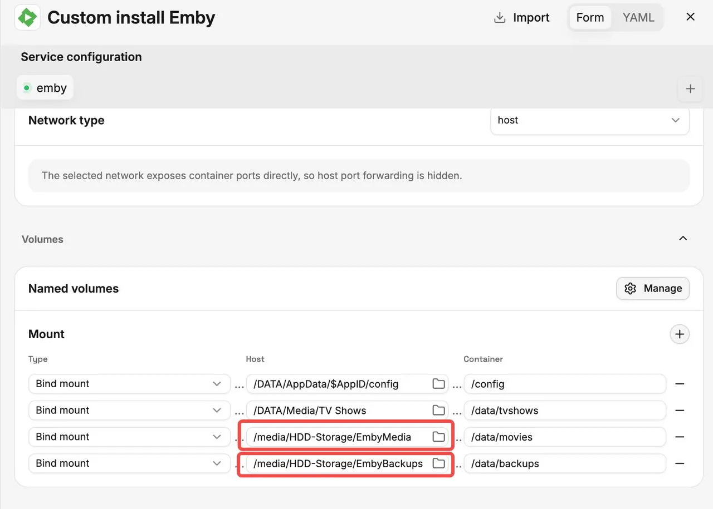
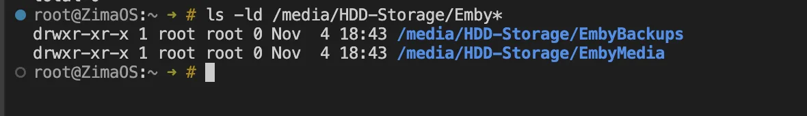
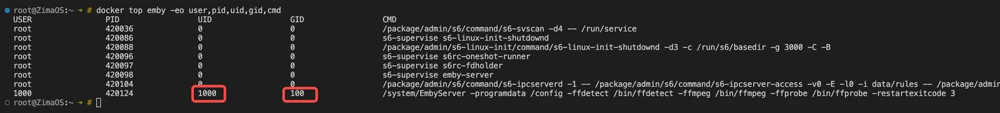

## Contexto

Después de añadir a Emby en ZimaOS carpetas multimedia o de copias de seguridad de un disco duro, es posible que Emby solo tenga acceso de lectura, aunque las carpetas estén montadas correctamente. Esto suele ocurrir cuando la propiedad y los permisos del directorio del host no conceden acceso de escritura al UID/GID que utiliza Emby.

Este tutorial explica cómo identificar el UID/GID con el que se ejecuta Emby y ajustar manualmente los permisos de los directorios correspondientes del host.

## Qué problemas ayuda a resolver este tutorial

Los siguientes problemas causados por permisos de escritura insuficientes:

- Emby puede leer y reproducir contenido multimedia, pero no puede guardar archivos NFO, pósteres u otros metadatos en el directorio multimedia.
- Las copias de seguridad fallan porque Emby no puede escribir en el directorio de copias de seguridad especificado.
- Aparece un error `Permission denied` al acceder a los directorios montados o escribir en ellos.

## Cómo cambiar los permisos

### 1. Localiza el directorio que debes modificar

Ve a **Emby → Manage → Mount**. El campo **Host** de la izquierda muestra el directorio real en ZimaOS, mientras que el campo **Container** de la derecha muestra la ruta utilizada dentro del contenedor de Emby.



Como se muestra en la captura de pantalla anterior, los directorios que debes modificar son:

```text
/media/HDD-Storage/EmbyMedia
/media/HDD-Storage/EmbyBackups
```

Aquí, "host" se refiere a estas dos rutas concretas, no a todo el directorio AppData o Media.



Como se muestra en la captura de pantalla, tanto **EmbyMedia** como **EmbyBackups** pertenecen a **root** y tienen permisos **755**, lo que significa que solo root tiene acceso de escritura. Si Emby se ejecuta como otro usuario, no puede guardar archivos NFO, pósteres ni copias de seguridad en estos directorios.

### 2. Identifica el UID/GID que utiliza Emby

Ejecuta el siguiente comando en el **terminal del host ZimaOS o en una sesión SSH**:

```bash
docker ps
```

Busca el nombre del contenedor de Emby y ejecuta el siguiente comando, sustituyendo `emby` por el nombre real:

```bash
docker top emby -eo user,pid,uid,gid,cmd
```

Localiza el proceso que contiene `EmbyServer` y anota su UID y GID.



### 3. Cambia la propiedad del directorio y los permisos de escritura

Suponiendo que el UID de Emby sea **1000** y el GID sea **100**, ejecuta:

```bash
sudo chown -R 1000:100 "/media/HDD-Storage/EmbyMedia"
sudo chown -R 1000:100 "/media/HDD-Storage/EmbyBackups"

sudo chmod -R u+rwX "/media/HDD-Storage/EmbyMedia"
sudo chmod -R u+rwX "/media/HDD-Storage/EmbyBackups"
```

Sustituye `1000:100` por el UID/GID real que hayas encontrado y comprueba que las rutas coincidan con tu configuración de **Host**. Estos comandos cambian la propiedad y los permisos de ambos directorios y de su contenido. Si otras aplicaciones comparten estos directorios, ten en cuenta también sus requisitos de acceso.

### 4. Comprueba el resultado en Emby

Intenta guardar archivos NFO, descargar pósteres o ejecutar una copia de seguridad de nuevo. Los cambios de permisos suelen aplicarse de inmediato, por lo que no es necesario reinstalar Emby.
