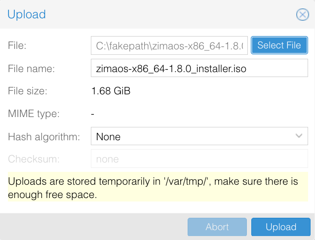

## Requisitos  
Requisitos de hardware y entorno  
- Un entorno Proxmox VE (PVE) operativo y accesible  
- Un CPU x86_64 con soporte de virtualización habilitado  
  Configuración mínima recomendada:  
  - CPU: 2 núcleos o más (se recomiendan 4 núcleos)  
  - Memoria: 4 GB o más (se recomiendan 8 GB)  
  - Almacenamiento: Al menos 32 GB de espacio disponible  

Requisitos de software y sistema  
- Imagen ISO de instalación de ZimaOS  
- Proxmox VE 6.x / 7.x / 8.x / 9.x  
- Modo de arranque de máquina virtual: UEFI  
- Tipo de BIOS de la VM: OVMF (UEFI)  

---  
## Pasos de instalación

> Los números de versión y los nombres de almacenamiento en las capturas de Proxmox son ejemplos.

### Subir la imagen ISO de ZimaOS
1. Descarga el archivo `_installer.iso` de [Versiones de ZimaOS en GitHub](https://github.com/IceWhaleTech/ZimaOS/releases).
2. En Proxmox VE, selecciona el nodo y un almacenamiento que admita ISO, por ejemplo **local → ISO Images → Upload**.
3. Selecciona el archivo ISO y haz clic en **Upload**.

### Crear una máquina virtual
Haz clic en **Create VM**, asigna un nombre y un ID a la VM y configura lo siguiente. Las etiquetas pueden variar entre versiones de Proxmox VE.

| Ajuste | Valor |
|---|---|
| OS | ISO de ZimaOS subida; sistema invitado Linux |
| BIOS | **OVMF (UEFI)** |
| Disco EFI | Activa **Add EFI Disk** y selecciona su almacenamiento |
| Secure Boot | Desmarca **Pre-Enroll keys** al crear el disco EFI |
| Disco de sistema | Al menos **32 GB**, disco SCSI con controlador VirtIO SCSI |
| CPU | Al menos **2 núcleos**; 4 recomendados |
| Memoria | Al menos **4096 MB**; 8192 MB recomendados |
| Red | Puente conectado a la LAN, como `vmbr0`, con un dispositivo de red VirtIO |

El disco EFI guarda los ajustes del firmware y es distinto del disco de sistema donde se instala ZimaOS. Mantén Secure Boot desactivado. Proxmox explica los discos EFI y las claves preinstaladas en [BIOS and UEFI](https://pve.proxmox.com/pve-docs/chapter-qm.html#_bios_and_uefi).

Finaliza el asistente. En **Options → Boot Order**, activa la unidad CD/DVD virtual para el primer arranque y mantén el disco de sistema disponible como dispositivo de arranque.

### Instalar ZimaOS
1. Inicia la VM y abre **Console**. Arranca desde la ISO conectada.
2. En la bienvenida del instalador gráfico de ZimaOS, haz clic en **Start** y elige el idioma.

3. Selecciona el disco de sistema de la VM y haz clic en **Continue**. Comprueba la capacidad: **se borrarán todos los datos del disco seleccionado**.
4. Revisa las comprobaciones de instalación y haz clic en **Continue**.
5. Confirma el disco de destino y haz clic en **Erase and install**.
6. Mantén la VM encendida hasta que aparezca la pantalla de instalación completa. También puedes ver las pantallas en la [guía de instalación de ZimaOS](./how-to-install-zimaos); los nombres de los discos serán distintos en una VM.

### Eliminar la imagen ISO
Antes de reiniciar desde la pantalla de instalación completa:
1. Abre la pestaña **Hardware** de la VM en Proxmox VE.
2. Selecciona **CD/DVD Drive**, haz clic en **Edit**, elige **Do not use any media** y haz clic en **OK**.

3. En **Options → Boot Order**, coloca primero el disco de sistema instalado. Mantén conectado el disco EFI.
4. Vuelve a **Console** y haz clic en **Restart** en el instalador.

### Iniciar y acceder a ZimaOS
Después de arrancar desde el disco de sistema, la consola de la VM muestra su dirección IP. Desde un ordenador con acceso a la red de la VM, introduce esa dirección en un navegador para abrir ZimaOS. También puedes usar ZimaClient en la misma red.

Si vuelve a aparecer el instalador, comprueba que la ISO esté desconectada y el disco de sistema sea el primero en el orden de arranque. Si UEFI muestra una infracción de seguridad, verifica que Secure Boot esté desactivado. Si no aparece una IP, comprueba el puente de red, el dispositivo de red virtual y el servicio DHCP.

## Continúe explorando ZimaOS
Sigue [Primeros pasos con ZimaOS](./get-started) para completar la configuración inicial y empezar a gestionar el almacenamiento y las aplicaciones.
