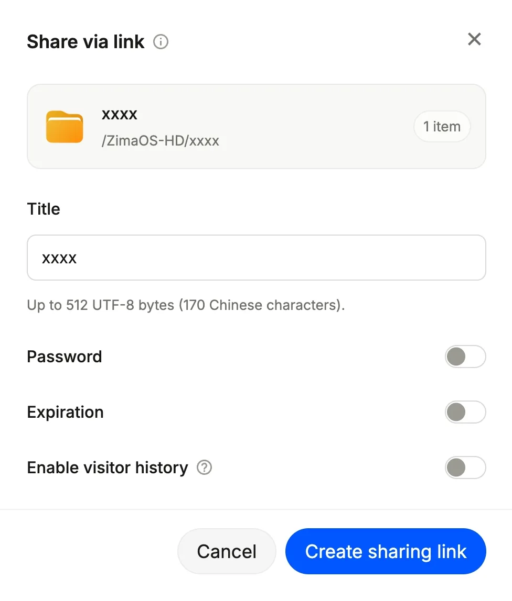
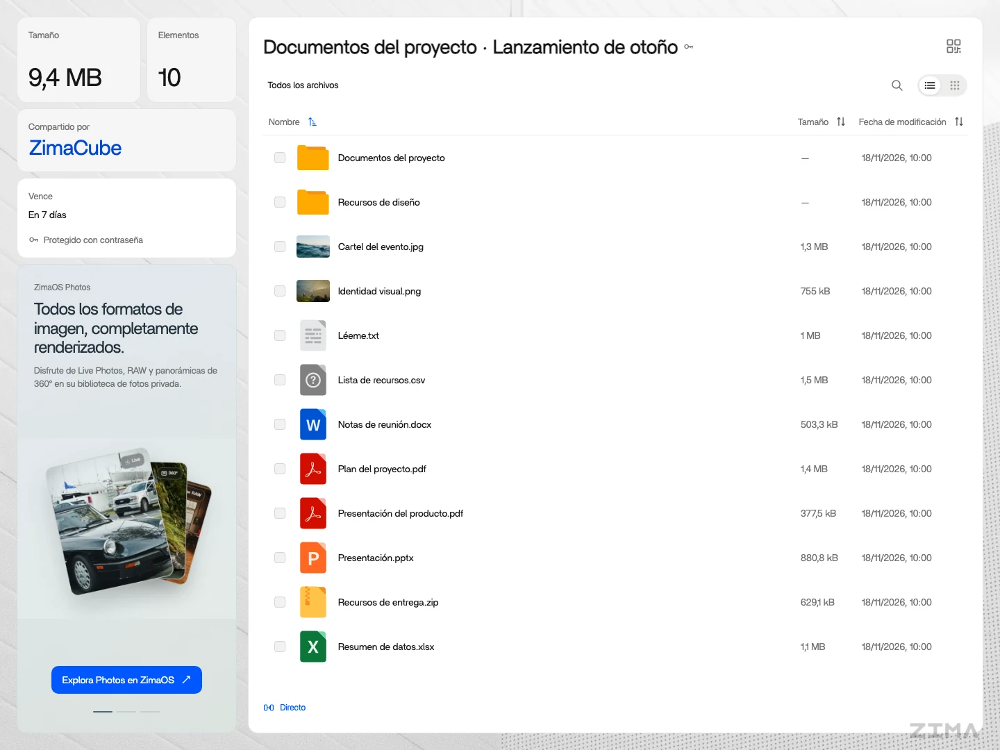
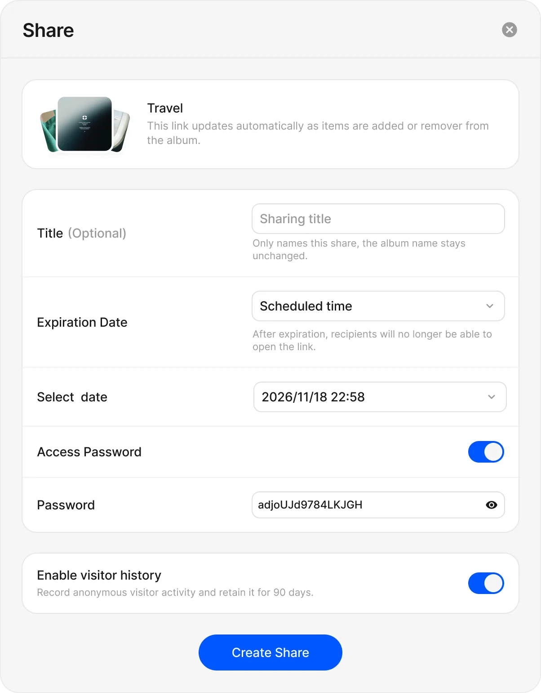
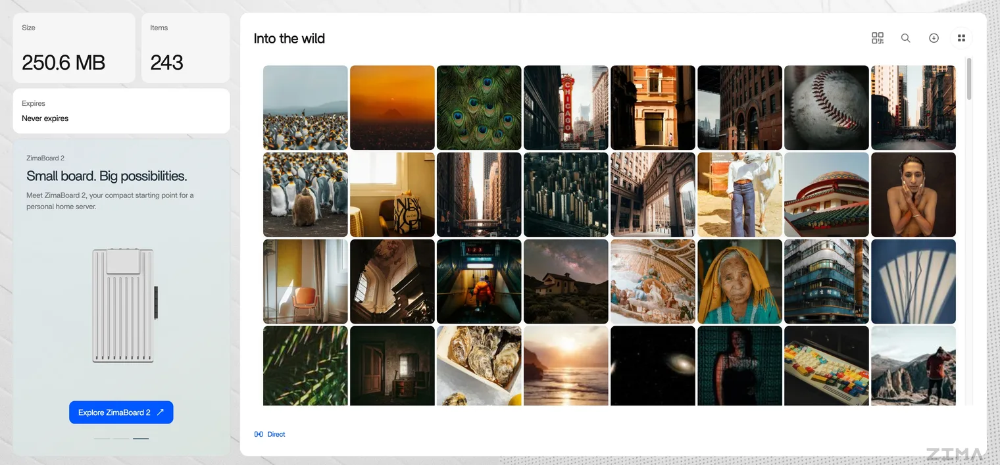
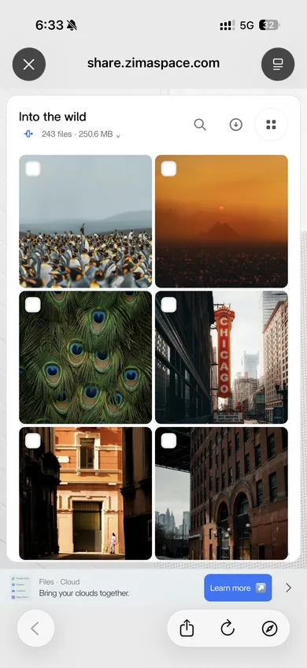
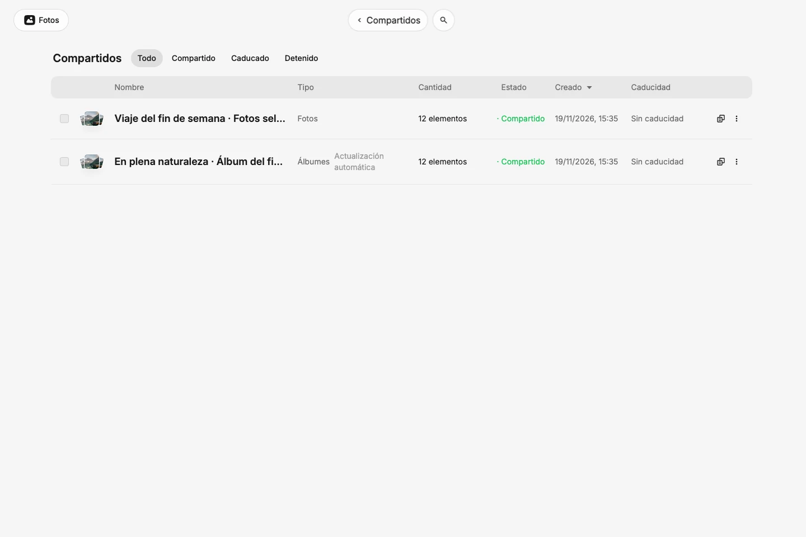
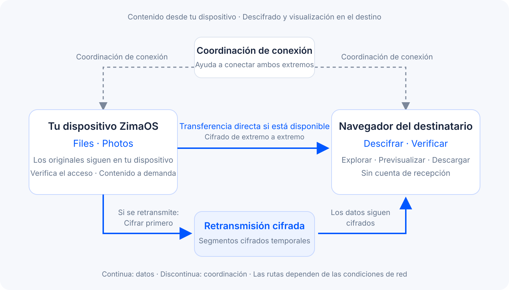

Envía materiales de un proyecto a un compañero, comparte las fotos del fin de semana con tu familia o mantén un álbum actualizado. Crea un enlace en ZimaOS y el destinatario podrá ver y descargar su contenido desde el navegador, sin una cuenta de ZimaOS ni una aplicación específica de recepción.

Tu dispositivo ZimaOS sigue proporcionando los archivos. Tú decides qué compartir, si se necesita una contraseña, cuándo caduca el enlace y cuándo dejar de compartir.

## Elige cómo compartir

| Qué quieres compartir | Dónde empezar | Para qué resulta útil |
| --- | --- | --- |
| Archivos, carpetas o un conjunto de documentos | Files | Entregar materiales de proyectos, enviar documentos y compartir una carpeta que se actualiza |
| Fotos seleccionadas | Photos | Recuerdos de viajes, fotos de eventos y entregas puntuales |
| Un álbum completo | Photos | Álbumes familiares y un portafolio que se actualiza |

> **Antes de empezar:** Mantén el dispositivo ZimaOS encendido y conectado, con el disco o almacenamiento de origen accesible. Se recomienda que el destinatario utilice una versión reciente de Chrome, Edge, Safari o Firefox. Las capturas utilizan contenido de demostración y no incluyen enlaces reales de usuarios. Las etiquetas pueden variar según la versión y el idioma de la aplicación; algunos ejemplos muestran etiquetas en inglés.

## Comparte documentos desde Files

### Crea un enlace

1. Abre **Files** y selecciona los archivos o carpetas que quieras compartir.
2. Abre **Compartir mediante un enlace** (**Share via link**) y escribe un título que permita identificar el contenido.
3. Configura la contraseña de acceso, la caducidad y el historial de visitas según necesites; después, selecciona **Crear enlace**.
4. Copia el enlace generado y envíalo al destinatario. Si has configurado una contraseña, facilítasela también. Para contenido sensible, considera enviar la contraseña por otro canal.

*Ventana de creación de Files. Revisa el contenido compartido y la configuración de acceso antes de enviar el enlace.*

### Qué ve el destinatario

Al abrir el enlace, el destinatario puede explorar carpetas, buscar archivos, alternar entre las vistas de lista y cuadrícula y previsualizar los formatos compatibles. Puede seleccionar los archivos o carpetas que necesite y descargarlos; varios elementos se pueden descargar en un archivo comprimido.

*Página de recepción de Files: primero explora y previsualiza; después, elige qué descargar.*

Cuando compartes una carpeta, su contenido sigue los cambios de la carpeta de origen. Tras añadir, eliminar o modificar archivos, el destinatario puede actualizar la página para ver el contenido actual. Para entregar una versión fija de un proyecto, organiza primero la versión final en una carpeta independiente.

## Comparte fotos desde Photos

### Comparte fotos seleccionadas o un álbum completo

Selecciona fotos o un álbum en **Photos** y utiliza **Compartir** para crear un enlace. Configura un título, una contraseña y la caducidad; después, copia el enlace para enviarlo.

*Ventana de creación de Photos. Las selecciones de fotos y los álbumes utilizan los mismos ajustes de uso compartido.*

La diferencia está en cómo cambia el contenido después:

| Opción | Qué ocurre después de crear el enlace |
| --- | --- |
| Fotos seleccionadas | Se comparten las fotos seleccionadas al crear el enlace. Las fotos nuevas no se añaden automáticamente. Para incluir más fotos, crea un nuevo enlace. |
| Un álbum completo | Sigue los cambios del álbum. Las fotos que añadas más adelante también formarán parte del contenido compartido. |

### Deja que el destinatario explore las fotos directamente

El enlace abre una página para explorar fotos. El destinatario puede alternar entre cuadrícula y mosaico, ajustar el tamaño de visualización, abrir vistas ampliadas, reproducir una presentación y seleccionar fotos para descargar. También puede consultar, bajo demanda, la información de captura disponible en las fotos compatibles.

*La página de recepción de Photos da prioridad a las fotos. Las miniaturas se cargan según se necesitan; las vistas ampliadas se solicitan al abrirlas.*

*También puedes explorar, seleccionar y descargar desde el teléfono sin instalar una aplicación de recepción.*

Las imágenes de previsualización no sobrescriben las fotos originales del dispositivo. Descargar un original conserva el formato y el contenido del archivo de origen. La disponibilidad de la vista previa depende del formato, de la capacidad de procesamiento del dispositivo y de la compatibilidad del navegador.

## Mantén el control de tus enlaces

### Contraseña y caducidad

Protege con contraseña el contenido que no sea público y elige una caducidad adecuada a su finalidad. La contraseña y la caducidad controlan los accesos posteriores. Los archivos que el destinatario ya haya guardado en su dispositivo no se pueden borrar a distancia haciendo caducar el enlace.

### Gestiona, modifica y detén el uso compartido

La gestión de enlaces permite comprobar el estado de los recursos compartidos, modificar los ajustes disponibles o dejar de compartir. En Photos también puedes distinguir las selecciones de fotos de los álbumes que se actualizan automáticamente.

*Selecciones de fotos y álbumes en la gestión de enlaces. Vuelve aquí para gestionar el acceso.*

Detener un recurso compartido impide nuevos accesos a través de su enlace. Eliminar permanentemente el registro de uso compartido borra ese registro, pero conserva los archivos originales en el dispositivo. Eliminar un álbum compartido también invalida su enlace; vaciarlo temporalmente no sustituye automáticamente el enlace por otro.

### Activa el historial de visitas solo si lo necesitas

El historial de visitas está desactivado de forma predeterminada. Si lo activas, puede mostrar la hora de visita, el tiempo aproximado con la página en primer plano y una IP de origen parcialmente oculta cuando se pueda obtener de forma fiable. Los orígenes que no se puedan obtener aparecerán como desconocidos. Los registros se conservan durante 90 días. Al desactivarlo se detiene la recopilación de nuevos datos; los registros existentes caducan según el plazo de conservación.

Esta información ayuda a conocer las visitas a un enlace. No permite confirmar de forma fiable la identidad del destinatario, y el tiempo en la página no demuestra que un archivo se haya leído por completo.

## Si un enlace no se abre

| Qué muestra la página | Qué hacer |
| --- | --- |
| Enlace no válido o incompleto | Vuelve a copiar el enlace completo del mensaje original. Si sigue siendo incorrecto, pide a quien lo comparte que lo envíe de nuevo. |
| Recurso compartido caducado o no disponible | Pide a quien lo comparte que amplíe la caducidad, confirme su estado o proporcione un enlace nuevo. |
| No se puede conectar temporalmente con el dispositivo | Comprueba ambas redes y confirma que ZimaOS y el almacenamiento de origen estén conectados; después, reinténtalo. También es posible que se haya detenido el uso compartido. |
| Enlace antiguo no compatible | Pide a quien lo comparte que actualice ZimaOS y las aplicaciones correspondientes y cree un enlace nuevo. |
| Error de previsualización | Reintenta la vista previa o descarga el original y ábrelo con una aplicación adecuada. |
| El navegador integrado del móvil impide descargar | Abre el enlace en un navegador independiente, como Safari o Chrome, y mantén la página abierta hasta que termine la descarga. |

La página intenta reconectar tras una desconexión temporal. Si aparece **Continuar descarga**, sigue esa indicación. La reutilización de los datos recibidos depende del navegador, del almacenamiento local y de si el archivo de origen ha cambiado. No des por hecho que todos los dispositivos pueden reanudar después de cerrar la pestaña.

## Más a fondo: disponibilidad, rendimiento y privacidad

A continuación se explica cómo funciona el uso compartido actual. No necesitas estos detalles para utilizarlo, pero ayudan a comprender su comportamiento en distintas redes y sus límites de seguridad.

### Cómo llegan los archivos al destinatario

*Resumen funcional. Las líneas continuas representan datos de archivos y las discontinuas, coordinación de la conexión. Ambas rutas de datos están protegidas mediante cifrado de extremo a extremo; no tienen por qué estar activas simultáneamente.*

**Tu dispositivo proporciona el contenido y comprueba el acceso.** Files y Photos ofrecen puntos de entrada diferentes. El servicio de uso compartido comprueba el estado actual del enlace, los permisos y la versión del archivo. Conocer el identificador de un archivo no concede permiso para leerlo.

**El navegador recibe, verifica y muestra el contenido.** Una vez autorizado el acceso, el navegador lee el contenido correspondiente, lo descifra y lo muestra en el extremo receptor. Las vistas previas, las miniaturas y los datos descargados también requieren autorización.

**Los servicios de red ayudan a conectar ambos extremos.** El sistema admite transferencias directas entre dispositivo y navegador, así como transferencias mediante retransmisión cifrada. La ruta depende de la red y de los servicios disponibles. La coordinación de conexiones y la retransmisión cumplen funciones diferentes.

### Disponibilidad: más de una forma de conectar

Las conexiones domésticas, las redes móviles y las redes empresariales presentan condiciones distintas. El sistema puede iniciar el acceso por una ruta disponible mientras prueba otras en segundo plano. Cuando la conexión directa no es posible, una retransmisión cifrada puede continuar la transferencia. Los fallos temporales generan reintentos limitados o ajustes de ruta, con el estado y las opciones de recuperación correspondientes en la página.

La transferencia se divide en segmentos. Un fallo recuperable no tiene por qué invalidar todo el contenido recibido. También se comprueba la versión de origen para evitar unir incorrectamente datos de antes y después de un cambio en el archivo.

Estos mecanismos mejoran la disponibilidad en redes complejas, pero no garantizan la conexión en cualquier red. El apagado del dispositivo, un almacenamiento inaccesible, un enlace detenido, cambios de permisos o servicios de red no disponibles pueden interrumpir el acceso. **La retransmisión cifrada no es una unidad en la nube que siga proporcionando archivos indefinidamente con tu dispositivo desconectado.**

### Rendimiento: muestra el contenido primero y transfiere más cuando haga falta

La exploración de fotos comienza con miniaturas pequeñas. Si hay información adecuada para una imagen provisional desenfocada, esta puede aparecer antes de la miniatura. Las vistas más nítidas y los detalles de captura se obtienen cuando se necesitan, evitando transferir todos los originales solo para explorar un álbum.

Las listas de archivos y colecciones grandes utilizan lecturas por lotes y representación del área visible para reducir la carga inicial. Las miniaturas almacenadas en caché pueden reutilizarse, siempre con las comprobaciones de autorización y versión actuales. Una búsqueda completa, la ordenación o abrir carpetas sin cargar pueden requerir lecturas adicionales.

Las descargas utilizan lecturas paralelas limitadas y adaptadas a la ruta. Si el navegador lo permite, los datos se escriben a medida que llegan. Esto ayuda a controlar la memoria para que un archivo grande no tenga que caber por completo en ella. Los métodos de guardado y los permisos de almacenamiento varían entre navegadores.

Como referencia, estas son velocidades medias de transferencias completas de un solo archivo en pruebas controladas. El tiempo incluye la finalización del guardado en el navegador y el contenido superó la validación. Se usan MB/s decimales (1 MB = 1.000.000 bytes). Son resultados de muestras, no picos instantáneos, límites fijos del producto ni velocidades garantizadas para todos los entornos. El tiempo no incluye establecer la conexión ni leer el manifiesto; la muestra de retransmisión se midió con la conexión ya preparada.

| Escenario de prueba | Velocidad de referencia de un archivo | Alcance |
| --- | --- | --- |
| Conexión directa: prueba local de envío y recepción | Aproximadamente 191 MB/s | Solo mide la ruta de software local; no acredita el rendimiento de una red física ni del disco del dispositivo |
| Retransmisión cifrada por Internet | 62,58 MB/s | Una transferencia completa con una configuración de prueba específica; hubo variaciones entre ejecuciones |

La velocidad real depende del ancho de banda de subida del dispositivo, la velocidad de lectura del disco, la red del destinatario, la ruta de transferencia y el navegador. Varios destinatarios simultáneos compiten por los recursos del dispositivo y la red; no forman automáticamente una red de distribución que se reenvíe archivos entre ellos.

### Privacidad: proteger el contenido y explicar los límites

**El contenido se cifra y descifra en los dos extremos.** Tanto la transferencia directa como la retransmisión utilizan cifrado de extremo a extremo. El servicio de retransmisión recibe segmentos cifrados, no archivos originales que pueda leer directamente. El cifrado y la verificación de integridad protegen conjuntamente el contenido transferido.

**La retransmisión temporal no es alojamiento público permanente.** Los segmentos cifrados están sujetos a autorización, caducidad y mecanismos de limpieza. La pérdida de acceso y el borrado físico del almacenamiento subyacente no ocurren en el mismo instante; no supongas que todas las copias desaparecen inmediatamente.

**Cifrar el contenido no proporciona anonimato en la red.** La infraestructura que establece conexiones, sirve páginas o retransmite datos puede procesar información de red necesaria, como IP y horas de conexión. Un enlace válido es un punto de acceso, y los destinatarios pueden guardar o reenviar los archivos recibidos. Facilita los enlaces y contraseñas solo a las personas adecuadas.

**El historial de visitas y el diagnóstico de conexión son distintos.** Quien comparte decide si activa el historial de visitas. El diagnóstico de calidad registra estados de conexión, tiempos, velocidades y categorías de fallo para mejorar la fiabilidad y la transferencia. No incluye el contenido de los archivos, nombres de archivo, enlaces compartidos, contraseñas ni claves de descifrado.

**Los metadatos de las fotos requieren atención aparte.** Los originales pueden contener fechas, ubicaciones y otra información. Consultar los detalles de captura bajo demanda no elimina automáticamente esos metadatos del original. Prepara una copia adecuada antes de compartir si no quieres que el destinatario reciba esa información.

**Gestiona también los datos del navegador en dispositivos compartidos.** Las miniaturas y las descargas pueden utilizar almacenamiento local del navegador. En un ordenador público, borra los datos del sitio y los archivos descargados cuando corresponda. Borrar datos locales también puede afectar a la reutilización de la caché y a la recuperación de descargas.

### Cumplimiento legal y exención de responsabilidad

**Comparte contenido de forma lícita y con los derechos necesarios.** Al compartir mediante enlaces, cumple las leyes y normativas aplicables y asegúrate de contar con los derechos o la autorización necesarios para compartir el contenido. No utilices esta función para difundir contenido ilícito ni para vulnerar derechos de autor, de privacidad, de imagen u otros derechos e intereses legítimos.

**El cifrado no sustituye a la autorización legal.** El cifrado de extremo a extremo, las contraseñas de acceso y los plazos de caducidad protegen la transferencia y controlan el acceso. No significan que se haya revisado la legalidad del contenido compartido ni que quien comparte o recibe el contenido tenga autorización para usarlo, copiarlo o redistribuirlo.

**Revisa qué compartes y quién lo recibirá.** Los destinatarios pueden guardar o reenviar el contenido recibido. Detener una compartición o dejar que caduque un enlace no retira los archivos que los destinatarios ya hayan guardado. Obtén la autorización necesaria antes de compartir información personal, material confidencial o contenido de terceros.

**Las comparticiones ilícitas o que vulneren derechos pueden restringirse.** Si se sospecha que el contenido compartido es ilícito o vulnera derechos de terceros, el proveedor del servicio puede restringir el acceso al enlace o suspender el servicio de compartición correspondiente de conformidad con la legislación aplicable. Estas medidas afectan al acceso compartido y no equivalen a borrar los archivos originales del dispositivo.

**Cada parte responde conforme a la ley.** Quienes comparten y quienes reciben contenido son responsables legalmente de sus propios actos de compartir, obtener y utilizar ese contenido. Este aviso no excluye ni limita las responsabilidades que deba asumir el proveedor del servicio conforme a la legislación aplicable.

## Sigue explorando

- [Conoce ZimaOS Photos](./photos)
- [Consulta los formatos de fotos compatibles con Photos](./photos-supported-formats)
- [Visita la comunidad ZimaSpace para obtener ayuda](https://community.zimaspace.com/)
