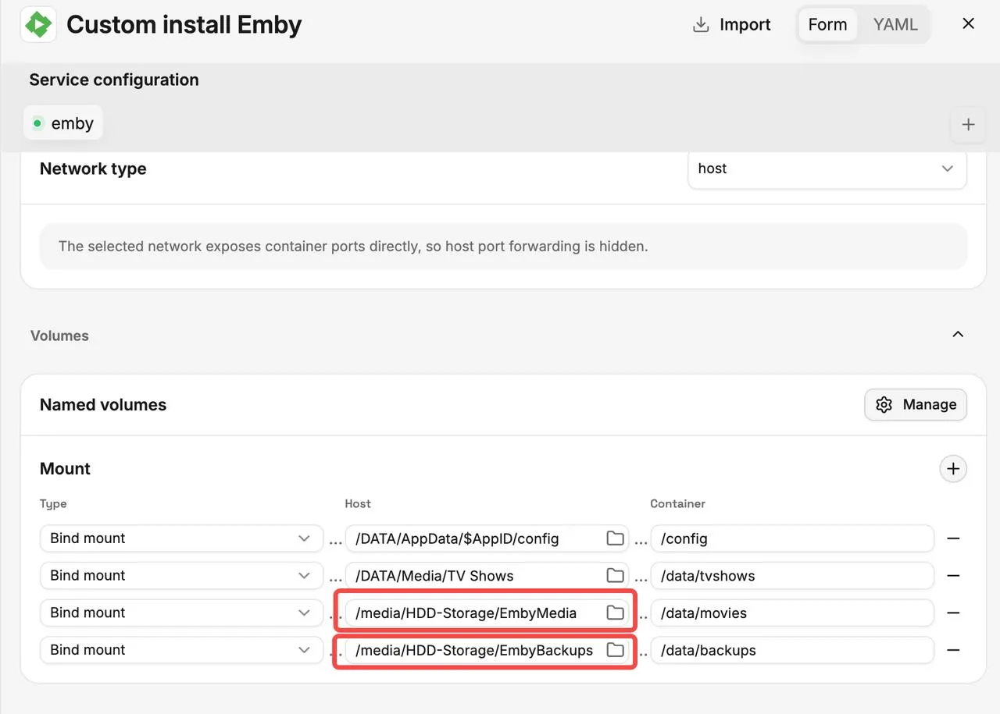
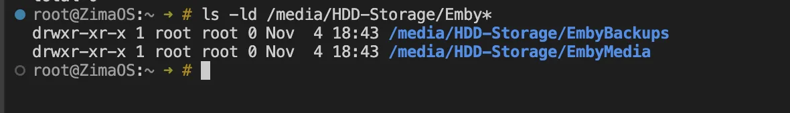
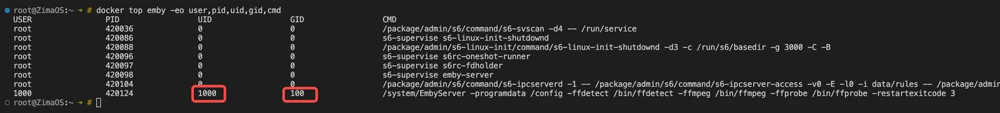

## 背景

ZimaOS の Emby にハードドライブ上のメディアフォルダやバックアップフォルダを追加した後、フォルダが正しくマウントされていても、Emby が読み取りしかできない場合があります。通常、これはホスト側ディレクトリの所有権と権限が、Emby の使用する UID/GID に書き込みを許可していないために起こります。

このチュートリアルでは、Emby の実行に使用される UID/GID を特定し、対応するホスト側ディレクトリの権限を手動で調整する方法を説明します。

## このチュートリアルで解決できる問題

書き込み権限の不足によって発生する、次のような問題を対象とします。

- Emby はメディアを読み取って再生できますが、NFO ファイル、ポスター、その他のメタデータをメディアディレクトリに保存できません。
- 指定したバックアップディレクトリに Emby が書き込めないため、バックアップが失敗します。
- マウントしたディレクトリへのアクセス時や書き込み時に、`Permission denied` エラーが表示されます。

## 権限の変更方法

### 1. 変更するディレクトリを確認する

**Emby → Manage → Mount** を開きます。左側の **Host** フィールドには ZimaOS 上の実際のディレクトリが表示され、右側の **Container** フィールドには Emby コンテナ内で使用されるパスが表示されます。



上のスクリーンショットの例では、変更するディレクトリは次のとおりです。

```text
/media/HDD-Storage/EmbyMedia
/media/HDD-Storage/EmbyBackups
```

ここでの「host」はこの 2 つの具体的なパスを指し、AppData ディレクトリや Media ディレクトリ全体を指すものではありません。



スクリーンショットのとおり、**EmbyMedia** と **EmbyBackups** はどちらも **root** が所有し、権限は **755** です。これは root だけが書き込みできることを意味します。Emby が別のユーザーとして実行されている場合、これらのディレクトリに NFO ファイル、ポスター、バックアップを保存できません。

### 2. Emby が使用する UID/GID を特定する

**ZimaOS ホストのターミナルまたは SSH セッション**で、次のコマンドを実行します。

```bash
docker ps
```

Emby コンテナの名前を確認し、`emby` を実際の名前に置き換えて次のコマンドを実行します。

```bash
docker top emby -eo user,pid,uid,gid,cmd
```

`EmbyServer` を含むプロセスを探し、その UID と GID を控えます。



### 3. ディレクトリの所有権と書き込み権限を変更する

Emby の UID が **1000**、GID が **100** の場合は、次のコマンドを実行します。

```bash
sudo chown -R 1000:100 "/media/HDD-Storage/EmbyMedia"
sudo chown -R 1000:100 "/media/HDD-Storage/EmbyBackups"

sudo chmod -R u+rwX "/media/HDD-Storage/EmbyMedia"
sudo chmod -R u+rwX "/media/HDD-Storage/EmbyBackups"
```

`1000:100` を確認した実際の UID/GID に置き換え、パスが **Host** の設定と一致していることを確認してください。これらのコマンドは、両方のディレクトリとその内容の所有権と権限を変更します。他のアプリケーションもこれらのディレクトリを共有している場合は、それらに必要なアクセス権も考慮してください。

### 4. Emby で確認する

NFO ファイルの保存、ポスターのダウンロード、バックアップの実行をもう一度試してください。権限の変更は通常すぐに反映されるため、Emby を再インストールする必要はありません。
