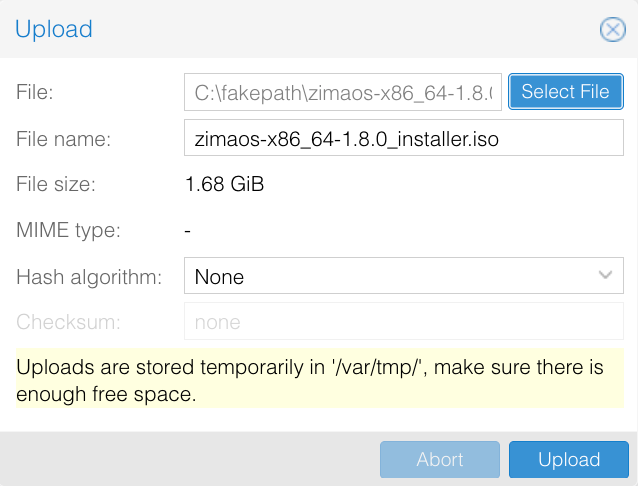

**ZimaOS ISOイメージ** の公式リリースにより、**Proxmox VE (PVE)** のような仮想化環境でZimaOSをより簡単にインストールして展開できるようになりました。  
このISOイメージは**仮想マシンインストール向けに最適化されており**、物理的なハードウェアなしでZimaOSを展開し、そのコア機能を迅速に探索できます。  
このインストール方法は、**テスト、学習、評価、および軽量な使用シナリオ**に最適です。

## はじめに
Proxmox VE (PVE) にZimaOSをインストールするということは、ZimaOSを物理ハードウェアに直接インストールするのではなく、**ISOイメージを使用して仮想マシンとして実行する**ということです。このアプローチにより、標準の仮想化環境内でZimaOSシステムとWebベースの管理インターフェースを体験できます。  
PVEにZimaOSを展開することで、既存のサーバーやホームラボで迅速に孤立したZimaOSインスタンスを作成できます。ベアメタルインストールと比較して、この方法にはいくつかの利点があります：
- より高速なセットアップと低い学習曲線
- 物理ハードウェアインストールに比べてリスクが低い
- スナップショットとバックアップによる環境の複製が簡単
- 柔軟なリソース割り当て（CPU、メモリ、ストレージ）
特に、**機能評価、ソリューション検証、および軽量サービス展開**に適しています。

---

## 必要条件
### ハードウェアおよび環境要件
- 動作しているアクセス可能なProxmox VE (PVE) 環境
- 仮想化サポートが有効なx86_64 CPU  
  推奨最小構成：
  - CPU: 2コア以上（4コア推奨）
  - メモリ: 4GB以上（8GB推奨）
  - ストレージ: 少なくとも32GBの空きディスクスペース

### ソフトウェアおよびシステム要件
- ZimaOS ISOインストールイメージ
- Proxmox VE 6.x / 7.x / 8.x / 9.x
- 仮想マシンブートモード: UEFI
- VM BIOSタイプ: OVMF（UEFI）

---

## インストール手順

> Proxmoxの画像内のバージョン番号とストレージ名は一例です。

### ZimaOS ISOイメージをアップロード
1. [ZimaOS GitHub Releases](https://github.com/IceWhaleTech/ZimaOS/releases)から `_installer.iso` ファイルをダウンロードします。
2. Proxmox VEでノードとISO対応ストレージを選びます。例：**local → ISO Images → Upload**。
3. ISOファイルを選び、**Upload** をクリックします。

### 仮想マシンを作成
**Create VM** をクリックし、VM名とIDを指定して次の設定を行います。Proxmox VEのバージョンによって表示名が異なる場合があります。

| 設定項目 | 値 |
|---|---|
| OS | アップロードしたZimaOS ISO、ゲストOSはLinux |
| BIOS | **OVMF (UEFI)** |
| EFIディスク | **Add EFI Disk** を有効にし、保存先を選択 |
| Secure Boot | EFIディスク作成時に **Pre-Enroll keys** のチェックを外す |
| システムディスク | **32 GB**以上、VirtIO SCSIコントローラーを使用するSCSIディスク |
| CPU | **2コア**以上、4コア推奨 |
| メモリー | **4096 MB**以上、8192 MB推奨 |
| ネットワーク | `vmbr0` などLANに接続したブリッジ、VirtIOネットワークデバイス |

EFIディスクはファームウェア設定の保存用で、ZimaOSをインストールするシステムディスクとは別です。Secure Bootは無効にしてください。EFIディスクと事前登録キーについては、Proxmoxの[BIOS and UEFI](https://pve.proxmox.com/pve-docs/chapter-qm.html#_bios_and_uefi)を参照してください。

ウィザードを完了します。**Options → Boot Order** で初回起動用の仮想CD/DVDドライブを有効にし、システムディスクも起動デバイスとして有効にしておきます。

### ZimaOSをインストール
1. VMを起動し、**Console** を開きます。接続したISOから起動します。
2. ZimaOSのグラフィカルインストーラーのようこそ画面で **Start** をクリックし、言語を選択します。

3. VMのシステムディスクを選び、**Continue** をクリックします。容量を確認してください。**選択したディスクの全データが消去されます**。
4. インストール前の確認結果を確認し、**Continue** をクリックします。
5. 対象ディスクを確認し、**Erase and install** をクリックします。
6. インストール完了画面が表示されるまでVMを起動したまま待ちます。画面の流れは[ZimaOSインストールガイド](./how-to-install-zimaos)でも確認できます。VMではディスク名が異なります。

### ISOイメージを削除
完了画面で再起動する前に、次の操作を行います。
1. Proxmox VEでVMの **Hardware** タブを開きます。
2. **CD/DVD Drive** を選択し、**Edit** → **Do not use any media** → **OK** の順に操作します。

3. **Options → Boot Order** でインストール済みのシステムディスクを先頭にします。EFIディスクは接続したままにします。
4. **Console** に戻り、インストーラーの **Restart** をクリックします。

### ZimaOSを起動してアクセス
システムディスクから起動すると、VMのコンソールにIPアドレスが表示されます。VMのネットワークに到達できるコンピューターのブラウザーにそのアドレスを入力し、ZimaOSを開きます。同じネットワーク上でZimaClientを使用することもできます。

再びインストーラーが表示される場合は、ISOが取り外され、システムディスクが起動順の先頭になっていることを確認します。UEFIにセキュリティ違反が表示される場合はSecure Bootが無効か確認してください。IPアドレスが表示されない場合は、VMのブリッジ、仮想ネットワークデバイス、DHCPサービスを確認します。

## ZimaOSの探索を続ける
[ZimaOSクイックスタートガイド](./get-started)で初期設定を完了し、ストレージとアプリの管理を始めてください。
