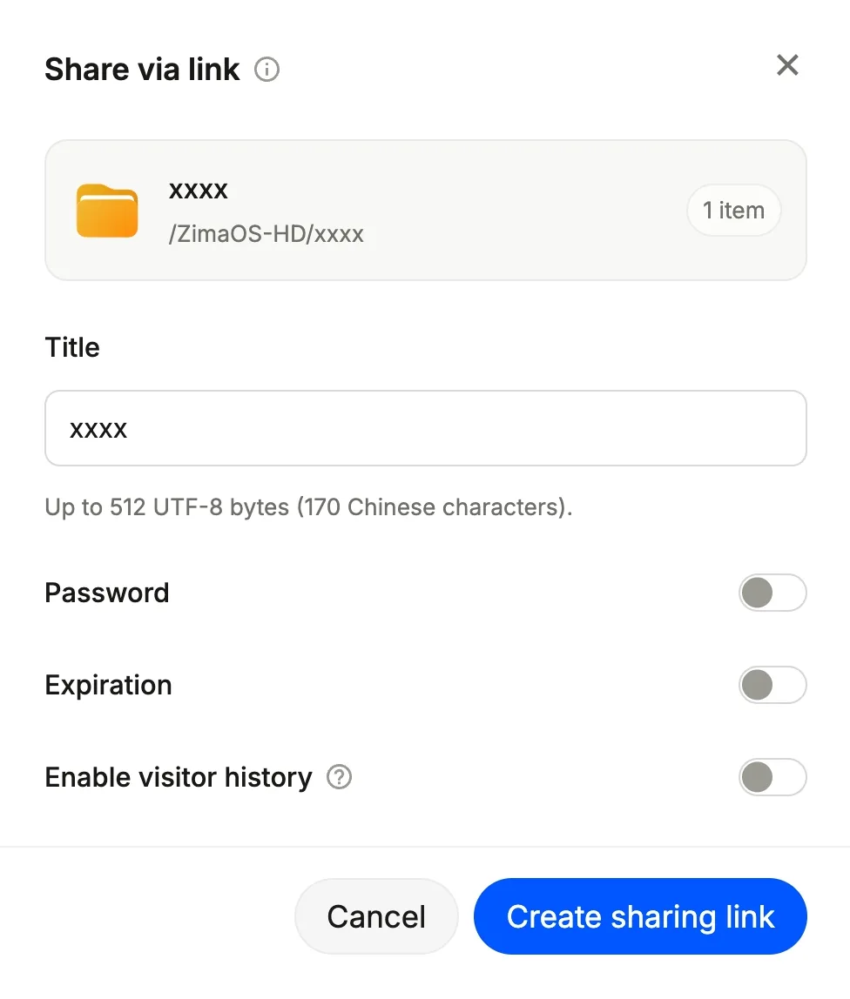
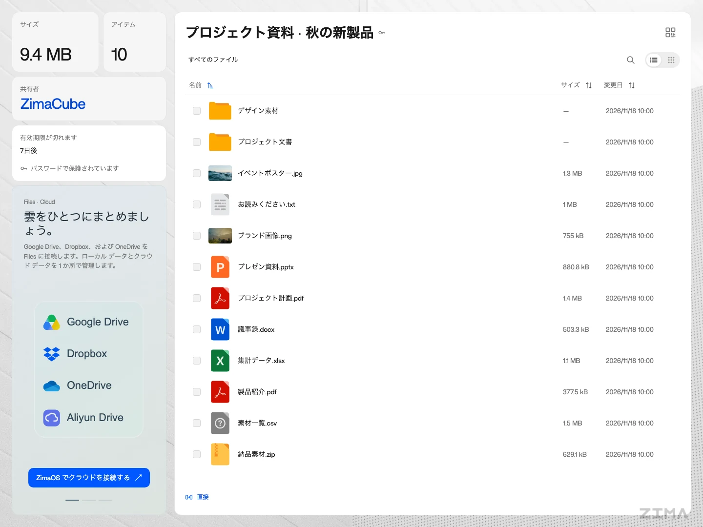
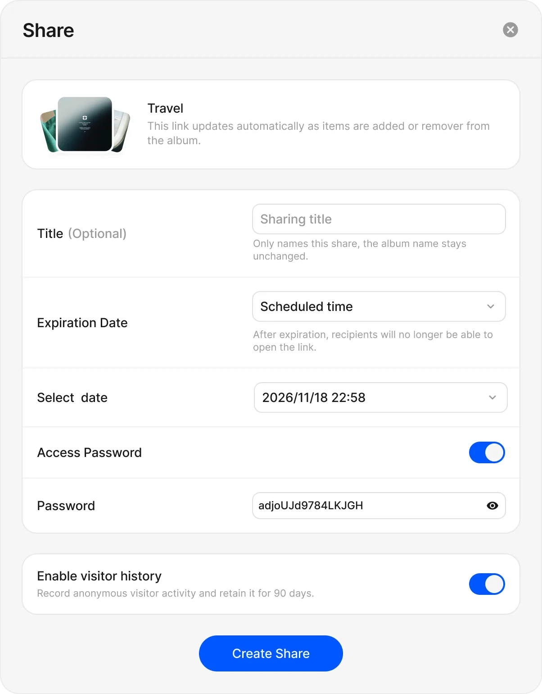
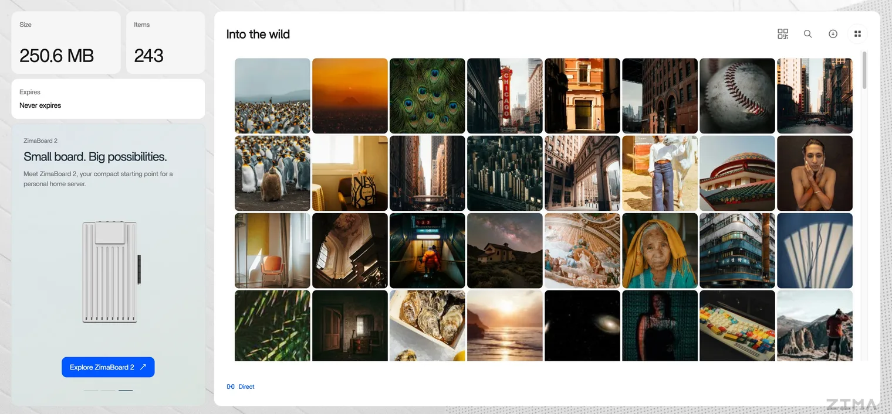
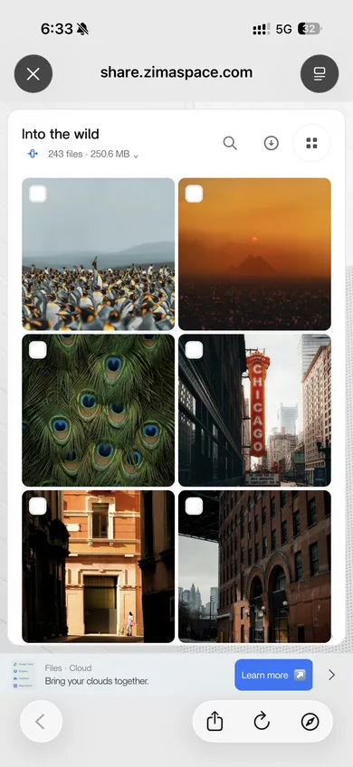
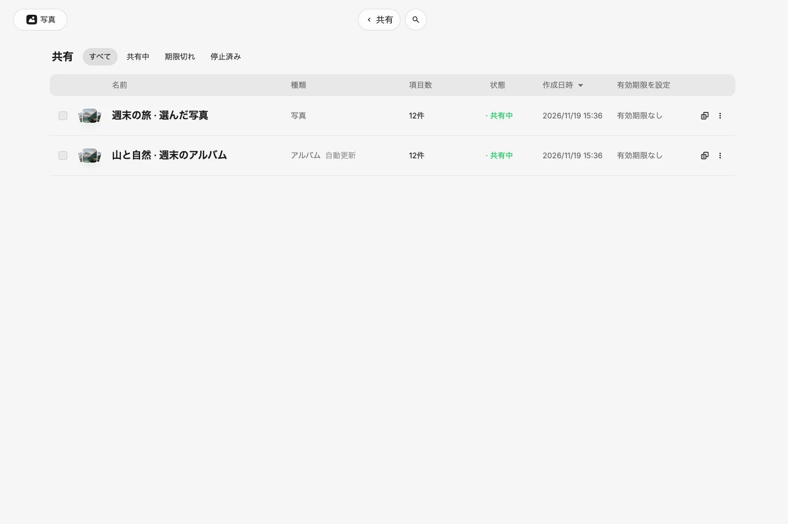
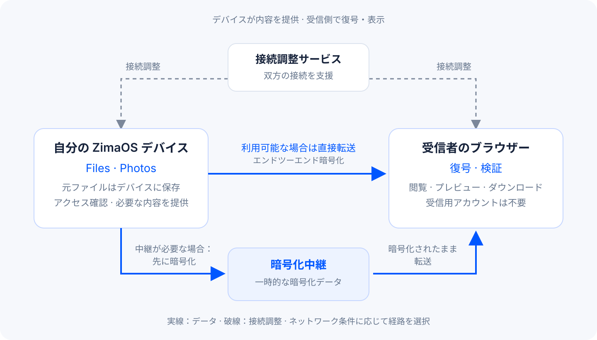

同僚にプロジェクト資料を送る、家族に週末の写真を見せる、アルバムを継続的に更新する。ZimaOS で共有リンクを作成すれば、相手は ZimaOS のアカウント登録や受信用アプリのインストールなしで、ブラウザーから内容を閲覧・ダウンロードできます。

ファイルは引き続き、あなたの ZimaOS デバイスから提供されます。共有する内容、パスワードの有無、リンクの有効期限、共有を停止するタイミングを自分で決められます。

## 共有する内容に合った方法を選ぶ

| 共有する内容 | 操作するアプリ | 主な用途 |
| --- | --- | --- |
| ファイル、フォルダー、資料一式 | Files | プロジェクト資料の納品、文書の送付、更新されるフォルダーの共有 |
| 選択した写真 | Photos | 旅行のベストショット、イベント写真、単発の納品 |
| アルバム全体 | Photos | 家族のアルバム、継続的に更新する作品集 |

> **始める前に：** ZimaOS デバイスの電源とネットワーク接続を維持し、元のディスクやストレージにアクセスできることを確認してください。受信者には、最新に近い Chrome、Edge、Safari、Firefox の利用をお勧めします。画面例にはデモ用の内容を使用しており、実際の利用者の共有リンクは含みません。表示名はアプリのバージョンや言語によって異なり、一部の画面例には英語の表示が含まれます。

## Files で資料を共有する

### リンクを作成する

1. **Files** を開き、共有するファイルやフォルダーを選択します。
2. **リンクで共有**（**Share via link**）を開き、内容が分かるタイトルを入力します。
3. 必要に応じてアクセスパスワード、有効期限、訪問履歴を設定し、**作成**を選択します。
4. 作成されたリンクをコピーして相手に送ります。パスワードを設定した場合は、それも伝えてください。機密性の高い資料では、パスワードを別の連絡手段で送ることをお勧めします。

*Files の作成画面。リンクを送る前に、共有内容とアクセス設定を確認できます。*

### 相手に表示される画面

リンクを開いた相手は、フォルダーの閲覧、ファイルの検索、リスト表示とグリッド表示の切り替え、対応形式のプレビューを利用できます。必要なファイルやフォルダーを選択してダウンロードでき、複数項目はアーカイブとしてまとめて取得できます。

*Files の受信ページ。内容を閲覧・プレビューしてから、必要な資料を選んでダウンロードできます。*

フォルダーの共有内容は元のフォルダーに追従します。ファイルの追加・削除・変更後、相手はページを更新して現在の内容を確認できます。特定のバージョンを納品する場合は、確定した資料を別のフォルダーにまとめてから共有してください。

## Photos で写真を共有する

### 選択した写真、またはアルバム全体を共有する

**Photos** で写真またはアルバムを選択し、**共有**からリンクを作成します。タイトル、アクセスパスワード、有効期限を設定したら、リンクをコピーして相手に送れます。

*Photos の作成画面。写真の選択共有とアルバム共有は、同じ共有設定を使用します。*

違いは、作成後に内容がどのように変わるかです。

| 共有方法 | 作成後の更新 |
| --- | --- |
| 選択した写真 | リンク作成時に選んだ写真を共有します。新しい写真は自動で追加されません。写真を追加したい場合は、新しい共有を作成してください。 |
| アルバム全体 | アルバムの変更に追従します。後からアルバムに追加した写真も共有に含まれます。 |

### 相手がそのまま写真を楽しめる

リンクを開くと、写真を閲覧するページが表示されます。相手はグリッド表示とウォーターフォール表示の切り替え、表示サイズの調整、大きなプレビュー、スライドショー、写真の選択とダウンロードを利用できます。対応する写真では、取得可能な撮影情報を必要なときに確認できます。

*写真を中心に見せる Photos の受信ページ。サムネイルは必要に応じて読み込み、大きなプレビューは開いたときに取得します。*

*スマートフォンでも受信用アプリをインストールせず、写真の閲覧・選択・ダウンロードができます。*

閲覧用のプレビューで、デバイス内の元の写真が上書きされることはありません。オリジナルをダウンロードすると、元ファイルの形式と内容が保持されます。プレビューの可否は、ファイル形式、デバイスの処理能力、ブラウザーの対応状況によって異なります。

## 共有を自分で管理する

### パスワードと有効期限

非公開の内容にはパスワードを設定し、用途に合った有効期限を選びましょう。パスワードと有効期限は、その後のアクセスを制御します。相手のデバイスに保存済みのファイルを、リンクの失効によって遠隔削除することはできません。

### 確認・変更・停止

共有管理では、作成済みの共有の状態を確認し、利用可能な設定を変更したり、共有を停止したりできます。Photos では、選択した写真と自動更新されるアルバムを区別して管理できます。

*共有管理に表示される写真の選択共有とアルバム。アクセス設定の管理もここから行えます。*

共有を停止すると、そのリンクによる後続のアクセスができなくなります。共有記録を完全に削除しても、元ファイルはデバイスに残ります。共有中のアルバム自体を削除した場合もリンクは無効になりますが、一時的にアルバムを空にしただけでは、別のリンクに自動で置き換わりません。

### 必要な場合だけ訪問履歴を有効にする

訪問履歴は初期設定で無効です。有効にすると、訪問時刻、ページが前面に表示されていたおおよその時間、信頼できる方法で取得できた場合の一部を伏せたアクセス元 IP アドレスを確認できます。取得できないアクセス元は不明と表示されます。記録の保存期間は 90 日です。無効にすると新しい収集は停止し、既存の記録は保存期間に従って削除されます。

これらの情報は、共有へのアクセス状況を把握するためのものです。相手の身元を正確に特定することはできず、滞在時間もファイルを最後まで読んだ証明にはなりません。

## リンクが開けない場合

| ページの状態 | 対処方法 |
| --- | --- |
| リンクが無効、または不完全 | 元のメッセージからリンク全体をコピーし直してください。解決しない場合は、共有者に再送を依頼してください。 |
| 共有が期限切れ、または利用不可 | 共有者に、有効期限の延長、共有状態の確認、または新しいリンクの発行を依頼してください。 |
| デバイスに一時的に接続できない | 双方のネットワークと、ZimaOS および元ストレージがオンラインかを確認してから再試行してください。共有が停止されている可能性もあります。 |
| 古いリンクがサポートされていない | 共有者に ZimaOS と関連アプリを更新してもらい、新しいリンクを作成してください。 |
| プレビューに失敗する | 再試行するか、オリジナルをダウンロードして対応アプリで開いてください。 |
| スマートフォンのアプリ内ブラウザーでダウンロードできない | Safari や Chrome などの単独ブラウザーで開き、ダウンロードが完了するまでページを開いたままにしてください。 |

一時的に接続が切れた場合、ページは再接続を試みます。**ダウンロードを続行**が表示された場合は、案内に従ってください。受信済みデータを再利用できるかは、ブラウザー、ローカルストレージ、元ファイルの変更有無によって異なります。すべてのデバイスで、タブを閉じた後も再開できるとは限りません。

## さらに詳しく：可用性・性能・プライバシー

ここからは、現在の共有機能の仕組みを説明します。利用するために必要な知識ではありませんが、ネットワークごとの動作やセキュリティ上の範囲を理解するのに役立ちます。

### ファイルが相手に届くまで

*機能の関係を示した図です。実線はファイルデータ、破線は接続調整を表します。どちらのデータ経路もエンドツーエンド暗号化で保護されますが、常に同時に使用されるわけではありません。*

**デバイスが内容の提供とアクセス確認を行います。** Files と Photos では共有の入口が異なります。共通の共有機能は、現在の共有状態、ファイル権限、ファイルのバージョンを確認します。ファイルの識別子を知っているだけでは、読み取り権限は得られません。

**ブラウザーが受信・検証・表示を行います。** アクセスが許可されてから対象の内容を読み取り、受信側で復号して表示します。プレビュー、サムネイル、ダウンロードデータにも認可が必要です。

**ネットワークサービスが双方の接続を支援します。** デバイスとブラウザー間の直接転送と、暗号化中継を利用した転送に対応します。使用する経路は、ネットワークや利用可能なサービスによって決まります。接続調整と中継は、それぞれ異なる役割を担います。

### 可用性：接続方法を一つに限定しない

家庭の回線、モバイル回線、企業ネットワークでは接続条件が異なります。システムは利用できる経路でアクセスを開始しながら、別の経路をバックグラウンドで確認できます。直接接続が利用できない場合は、暗号化中継で転送を継続できます。一時的な失敗では、回数などを制限した再試行や経路調整を行い、ページ上にも状態や復旧操作を表示します。

データは分割して転送されるため、復旧可能な失敗で受信済みの内容すべてが無効になるとは限りません。また、元ファイルのバージョンを確認し、変更前後のデータを誤って結合しないようにします。

こうした仕組みは複雑なネットワークでの可用性を高めますが、すべての環境での接続を保証するものではありません。デバイスの電源オフ、ストレージの利用不可、共有の停止、権限の変更、ネットワークサービスの停止などでアクセスは中断されます。**暗号化中継は、デバイスがオフラインでもファイルを無期限に提供するクラウドドライブではありません。**

### 性能：まず内容を見せ、必要な分を取得する

写真の閲覧は小さなサムネイルから始まります。適切なぼかし画像用の情報がある場合は、サムネイルより先に仮表示を行えます。鮮明なプレビューや撮影情報は必要になったときに取得するため、アルバムを見るだけで全オリジナルを転送する必要はありません。

大量のファイルや写真は、まとめて行う分割読み取りと表示領域に応じた描画により、初期の処理量を抑えます。キャッシュ済みのサムネイルも、現在の認可とファイルバージョンの確認を経て再利用できます。全体検索、並べ替え、未取得のフォルダーへの移動には追加の読み取りが必要な場合があります。

ダウンロードでは、経路に応じて並列読み取り数を制限し、ブラウザーが対応していれば受信しながら書き込みます。これによりメモリー使用量を抑え、大きなファイル全体をメモリーに置かずに処理できます。保存方法やストレージ権限はブラウザーによって異なります。

参考として、管理された条件で測定した単一ファイルの完全転送の平均速度を示します。計測にはブラウザーでの保存完了を含み、ファイル内容の検証にも合格しています。単位は十進表記の MB/s（1 MB = 1,000,000 バイト）です。これらは測定例であり、瞬間的なピーク、製品の固定上限、あらゆる環境での保証速度を示すものではありません。接続の確立とファイル一覧の取得は計測に含まず、中継の測定では接続を事前に準備しています。

| テスト条件 | 単一ファイルの参考速度 | 測定範囲 |
| --- | --- | --- |
| 直接接続：ローカル送受信テスト | 約 191 MB/s | 同一マシン上のソフトウェア経路のみ。物理ネットワークやデバイスのディスク性能を示すものではありません |
| インターネット経由の暗号化中継 | 62.58 MB/s | 特定のテスト構成での完全転送の一例。複数回の測定では変動があります |

実際の速度は、共有デバイスの上り帯域、ディスク速度、受信者のネットワーク、転送経路、ブラウザーの能力に左右されます。複数人が同時にダウンロードするとデバイスや回線のリソースを共有しますが、受信者同士でファイルを配信し合うネットワークが自動的に作られるわけではありません。

### プライバシー：内容を保護し、範囲を明確にする

**内容は両端で暗号化・復号されます。** 直接転送と中継転送のどちらも、エンドツーエンド暗号化を使用します。中継サービスが受け取るのは暗号化された断片であり、そのまま読める元ファイルではありません。暗号化と完全性の検証を組み合わせて転送内容を保護します。

**一時的な中継は、恒久的な公開保管ではありません。** 暗号化された断片には認可、有効期限、クリーンアップの仕組みがあります。アクセスの失効と、保存先での物理的な削除は同時ではありません。すべてのコピーが直ちに消えるとは考えないでください。

**内容の暗号化は、ネットワーク上の匿名性を保証しません。** 接続の確立、ページの配信、中継を行う基盤は、IP アドレスや接続時刻など必要なネットワーク情報を処理する場合があります。有効なリンクはアクセスの入口であり、受信者は取得したファイルを保存・転送できます。リンクとパスワードは、適切な相手にだけ伝えてください。

**訪問履歴と接続品質の診断は別のものです。** 訪問履歴を有効にするかは共有者が決めます。接続品質の診断では、安定性や転送動作の改善のため、接続状態、所要時間、速度、失敗の分類などを記録します。ファイル本文、ファイル名、共有リンク、パスワード、復号鍵は含みません。

**写真のメタデータには個別の確認が必要です。** オリジナルには撮影日時や位置などの情報が含まれる場合があります。撮影情報を必要なときだけ読み込むことは、元画像からのメタデータ削除を意味しません。相手に渡したくない情報がある場合は、公開用のコピーを用意してから共有してください。

**共有端末ではブラウザー内のデータも管理してください。** サムネイルのキャッシュやダウンロードで、ブラウザーのローカルストレージを使用する場合があります。公共のパソコンでは、利用後に必要に応じてサイトデータとダウンロード済みファイルを削除してください。ローカルデータの削除により、キャッシュの再利用やダウンロードの復旧ができなくなる場合もあります。

### 法令遵守と免責事項

**適法に、必要な権利を有する内容を共有してください。** リンク共有機能を利用する際は、適用される法令を遵守し、対象の内容を共有する権利または必要な許諾を有していることを確認してください。本機能を利用して違法な内容を配布したり、他者の著作権、プライバシー権、肖像権その他の正当な権利・利益を侵害したりしないでください。

**暗号化は、法的な許諾の代わりにはなりません。** エンドツーエンド暗号化、アクセスパスワード、有効期限は、転送の保護とアクセスの制御を目的としています。共有内容の適法性が審査済みであることや、共有者または受信者がその内容を使用・複製・再配布する許諾を得ていることを意味するものではありません。

**送信前に、共有範囲と受信者を確認してください。** 受信者は、取得した内容を保存・転送する場合があります。共有の停止やリンクの期限切れによって、受信者がすでに保存したファイルを回収することはできません。個人情報、機密資料、第三者の内容を共有する場合は、事前に必要な許諾を得てください。

**違法または権利侵害のおそれがある共有は、制限される場合があります。** 共有内容に違法行為や権利侵害の疑いがある場合、サービス提供者は適用法令に従ってリンクへのアクセスを制限し、または該当する共有サービスを停止することがあります。これらの措置は共有アクセスを対象とし、デバイス上の元ファイルの削除を意味するものではありません。

**各当事者は、法令に従って責任を負います。** 共有者と受信者は、それぞれの共有、取得、使用行為について法令上の責任を負います。本説明は、サービス提供者が適用法令に基づき負う責任を免除または制限するものではありません。

## 関連情報

- [ZimaOS Photos を詳しく見る](./photos)
- [Photos が対応する写真形式を確認する](./photos-supported-formats)
- [ZimaSpace コミュニティでサポートを探す](https://community.zimaspace.com/)
