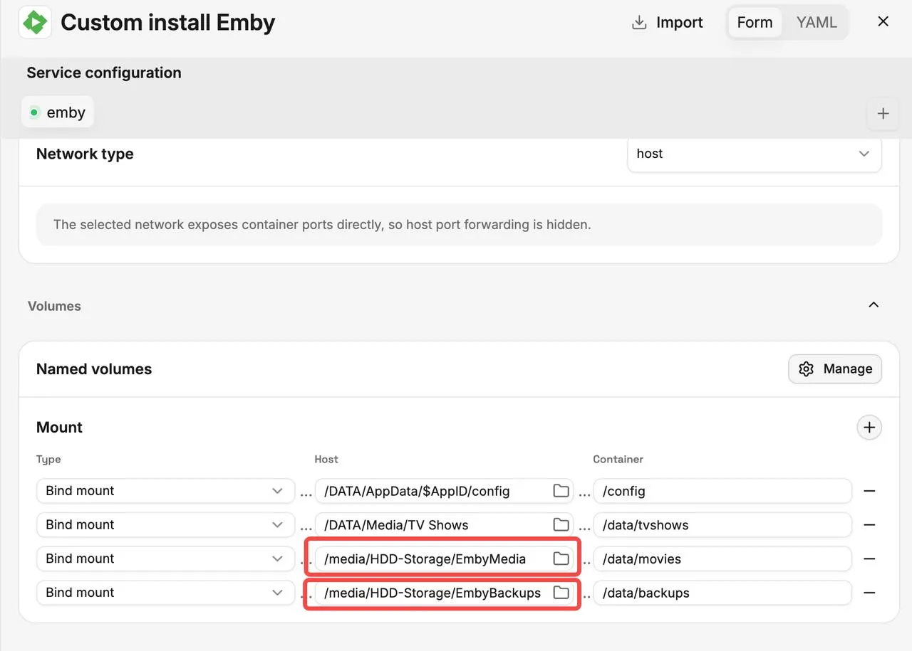
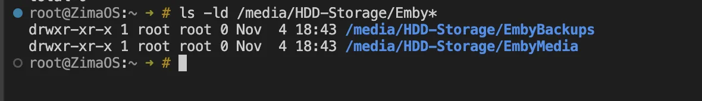
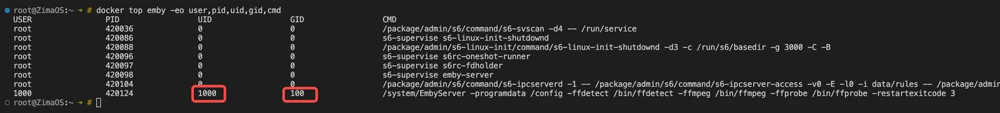

## Contexto

Depois de adicionar ao Emby em ZimaOS pastas de multimédia ou de cópias de segurança de um disco rígido, o Emby poderá ter apenas acesso de leitura, mesmo quando as pastas estão montadas corretamente. Isto acontece normalmente quando a propriedade e as permissões do diretório do anfitrião não concedem acesso de escrita ao UID/GID utilizado pelo Emby.

Este tutorial explica como identificar o UID/GID com que o Emby é executado e ajustar manualmente as permissões dos diretórios correspondentes do anfitrião.

## Que problemas ajuda este tutorial a resolver

Os seguintes problemas causados por permissões de escrita insuficientes:

- O Emby consegue ler e reproduzir conteúdo multimédia, mas não consegue guardar ficheiros NFO, cartazes ou outros metadados no diretório de multimédia.
- As cópias de segurança falham porque o Emby não consegue escrever no diretório de cópias de segurança especificado.
- É apresentado um erro `Permission denied` ao aceder ou escrever nos diretórios montados.

## Como alterar as permissões

### 1. Localizar o diretório a modificar

Aceda a **Emby → Manage → Mount**. O campo **Host**, à esquerda, mostra o diretório real em ZimaOS, enquanto o campo **Container**, à direita, mostra o caminho utilizado dentro do contentor do Emby.



Como mostra a captura de ecrã acima, os diretórios a modificar são:

```text
/media/HDD-Storage/EmbyMedia
/media/HDD-Storage/EmbyBackups
```

Aqui, "host" refere-se a estes dois caminhos específicos, não ao diretório AppData ou Media completo.



Como mostra a captura de ecrã, tanto **EmbyMedia** como **EmbyBackups** pertencem a **root** e têm permissões **755**, o que significa que apenas root tem acesso de escrita. Se o Emby for executado como outro utilizador, não consegue guardar ficheiros NFO, cartazes ou cópias de segurança nestes diretórios.

### 2. Identificar o UID/GID utilizado pelo Emby

Execute o seguinte comando no **terminal do anfitrião ZimaOS ou numa sessão SSH**:

```bash
docker ps
```

Encontre o nome do contentor do Emby e execute o seguinte comando, substituindo `emby` pelo nome real:

```bash
docker top emby -eo user,pid,uid,gid,cmd
```

Localize o processo que contém `EmbyServer` e anote o respetivo UID e GID.



### 3. Alterar a propriedade do diretório e as permissões de escrita

Supondo que o UID do Emby é **1000** e o GID é **100**, execute:

```bash
sudo chown -R 1000:100 "/media/HDD-Storage/EmbyMedia"
sudo chown -R 1000:100 "/media/HDD-Storage/EmbyBackups"

sudo chmod -R u+rwX "/media/HDD-Storage/EmbyMedia"
sudo chmod -R u+rwX "/media/HDD-Storage/EmbyBackups"
```

Substitua `1000:100` pelo UID/GID real que encontrou e certifique-se de que os caminhos correspondem à sua configuração de **Host**. Estes comandos alteram a propriedade e as permissões de ambos os diretórios e dos respetivos conteúdos. Se outras aplicações partilharem estes diretórios, tenha também em conta os seus requisitos de acesso.

### 4. Verificar no Emby

Tente guardar ficheiros NFO, transferir cartazes ou executar uma cópia de segurança novamente. As alterações de permissões normalmente têm efeito imediato, pelo que não é necessário reinstalar o Emby.
