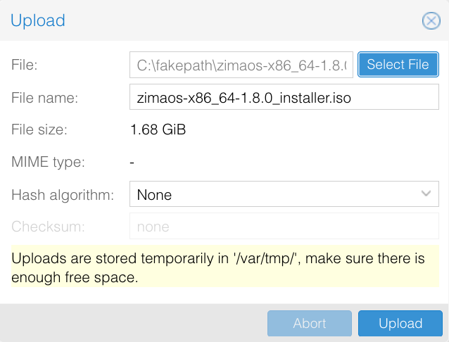
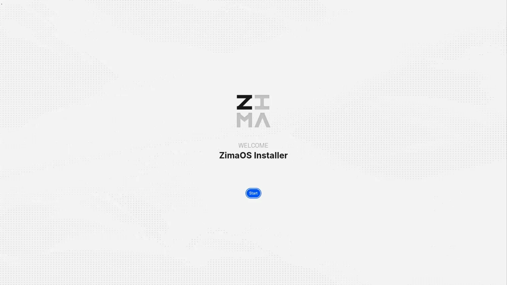

**C**om o lançamento oficial da **imagem ISO do ZimaOS**, agora é possível instalar e implantar o ZimaOS de maneira mais fácil em ambientes virtualizados, como o **Proxmox VE (PVE)**.  
Esta imagem ISO é **especificamente otimizada para instalação em máquina virtual**, permitindo que você implemente o ZimaOS sem hardware físico e explore rapidamente seus principais recursos.  
Este método de instalação é ideal para **testes, aprendizado, avaliação e cenários de uso leve**.

## Introdução
Instalar o ZimaOS no Proxmox VE (PVE) significa executar o ZimaOS como uma **máquina virtual usando uma imagem ISO**, em vez de instalá-lo diretamente em hardware físico. Esse método permite que você experimente o sistema completo do ZimaOS e a interface de gerenciamento baseada na web em um ambiente de virtualização padrão.  
Ao implantar o ZimaOS no PVE, você pode rapidamente criar uma instância isolada do ZimaOS em seu servidor ou laboratório doméstico existente. Em comparação com a instalação em hardware físico, este método oferece várias vantagens:
- Configuração mais rápida com uma curva de aprendizado menor
- Menor risco em comparação com a instalação direta em hardware
- Facilidade para replicar ambientes com snapshots e backups
- Alocação flexível de recursos (CPU, memória, armazenamento)
É especialmente adequado para **avaliação de recursos, validação de soluções e implantação de serviços leves**.
---

## Requisitos
Requisitos de Hardware e Ambiente
- Um ambiente Proxmox VE (PVE) funcionando e acessível
- Um processador x86_64 com suporte a virtualização habilitado  
Configuração mínima recomendada:
- CPU: 2 núcleos ou mais (4 núcleos recomendados)
- Memória: 4 GB ou mais (8 GB recomendados)
- Armazenamento: Pelo menos 32 GB de espaço disponível no disco

Requisitos de Software e Sistema
- Imagem ISO de instalação do ZimaOS
- Proxmox VE 6.x / 7.x / 8.x / 9.x
- Modo de inicialização da máquina virtual: UEFI
- Tipo de BIOS da VM: OVMF (UEFI)

---
## Passos de Instalação

> Os números de versão e os nomes de armazenamento nas imagens do Proxmox são exemplos.

### Carregar a Imagem ISO do ZimaOS
1. Transfira o ficheiro `_installer.iso` das [versões do ZimaOS no GitHub](https://github.com/IceWhaleTech/ZimaOS/releases).
2. No Proxmox VE, selecione o nó e um armazenamento com suporte para ISO, como **local → ISO Images → Upload**.
3. Selecione o ficheiro ISO e clique em **Upload**.

### Criar uma Máquina Virtual
Clique em **Create VM**, atribua um nome e um ID à VM e configure as opções seguintes. Os nomes podem variar entre versões do Proxmox VE.

| Definição | Valor |
|---|---|
| OS | ISO do ZimaOS carregada; sistema convidado Linux |
| BIOS | **OVMF (UEFI)** |
| Disco EFI | Ative **Add EFI Disk** e selecione o armazenamento |
| Secure Boot | Desmarque **Pre-Enroll keys** ao criar o disco EFI |
| Disco de sistema | Pelo menos **32 GB**, disco SCSI com controlador VirtIO SCSI |
| CPU | Pelo menos **2 núcleos**; 4 recomendados |
| Memória | Pelo menos **4096 MB**; 8192 MB recomendados |
| Rede | Bridge ligada à LAN, como `vmbr0`, com dispositivo de rede VirtIO |

O disco EFI guarda as definições do firmware e é distinto do disco de sistema onde o ZimaOS é instalado. Mantenha o Secure Boot desativado. O Proxmox descreve os discos EFI e as chaves pré-registadas em [BIOS and UEFI](https://pve.proxmox.com/pve-docs/chapter-qm.html#_bios_and_uefi).

Conclua o assistente. Em **Options → Boot Order**, ative a unidade CD/DVD virtual para o primeiro arranque e mantenha o disco de sistema disponível como dispositivo de arranque.

### Instalar o ZimaOS
1. Inicie a VM e abra **Console**. Arranque a partir da ISO ligada.
2. No ecrã de boas-vindas do instalador gráfico do ZimaOS, clique em **Start** e selecione o idioma.

3. Selecione o disco de sistema da VM e clique em **Continue**. Confirme a capacidade: **todos os dados do disco selecionado serão apagados**.
4. Reveja as verificações da instalação e clique em **Continue**.
5. Confirme o disco de destino e clique em **Erase and install**.
6. Mantenha a VM ligada até surgir o ecrã de instalação concluída. As imagens também estão no [guia de instalação do ZimaOS](./how-to-install-zimaos); os nomes dos discos serão diferentes numa VM.

### Remover a Imagem ISO
Antes de reiniciar a partir do ecrã de conclusão:
1. Abra o separador **Hardware** da VM no Proxmox VE.
2. Selecione **CD/DVD Drive**, clique em **Edit**, escolha **Do not use any media** e clique em **OK**.

3. Em **Options → Boot Order**, coloque o disco de sistema instalado em primeiro lugar. Mantenha o disco EFI ligado.
4. Regresse a **Console** e clique em **Restart** no instalador.

### Iniciar e Acessar o ZimaOS
Depois de arrancar a partir do disco de sistema, a consola da VM apresenta o endereço IP. Num computador com acesso à rede da VM, introduza esse endereço num navegador para abrir o ZimaOS. Também pode usar o ZimaClient na mesma rede.

Se o instalador voltar a aparecer, confirme que a ISO está desligada e que o disco de sistema é o primeiro na ordem de arranque. Se a UEFI indicar uma violação de segurança, confirme que o Secure Boot está desativado. Se não aparecer um IP, verifique a bridge, o dispositivo de rede virtual e o serviço DHCP.

## Continuar Explorando o ZimaOS
Siga [Primeiros passos com o ZimaOS](./get-started) para concluir a configuração inicial e começar a gerir o armazenamento e as aplicações.
