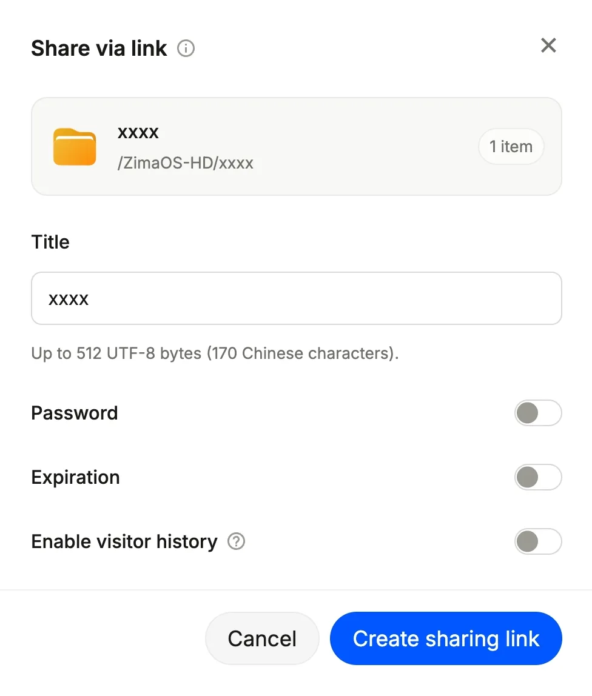
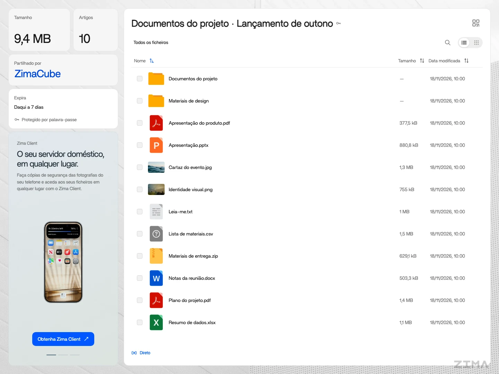
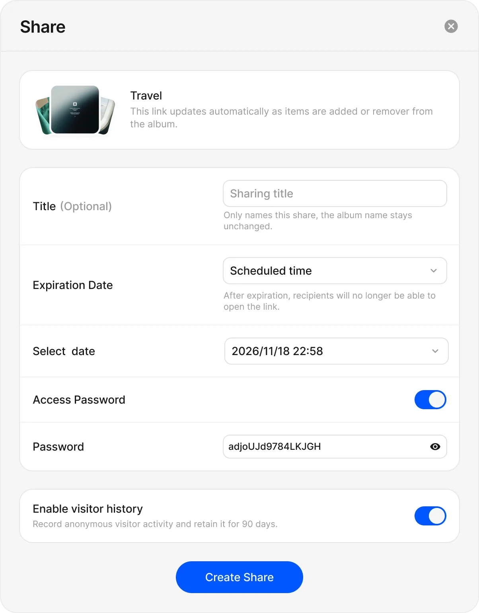
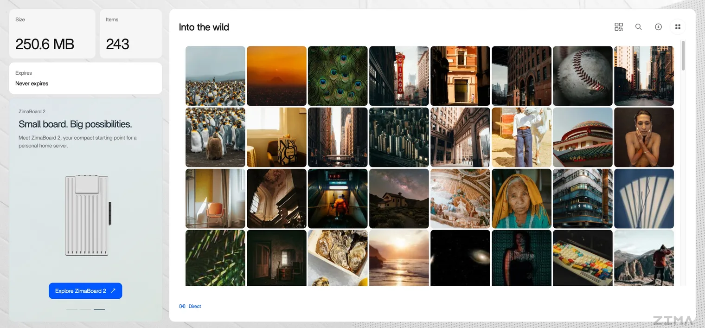
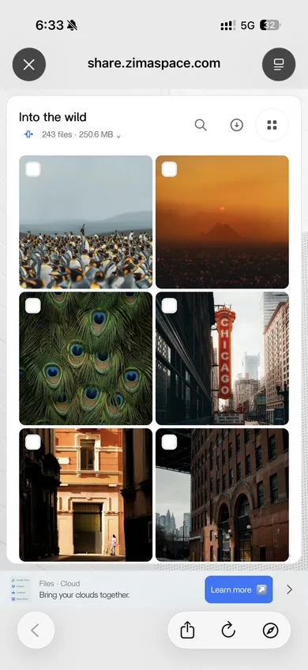
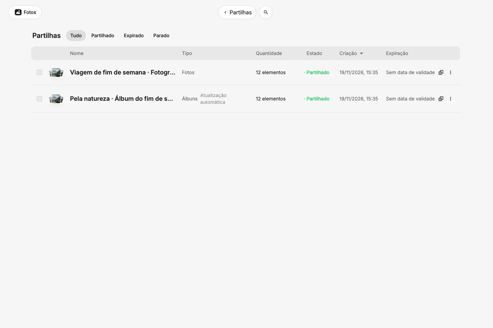
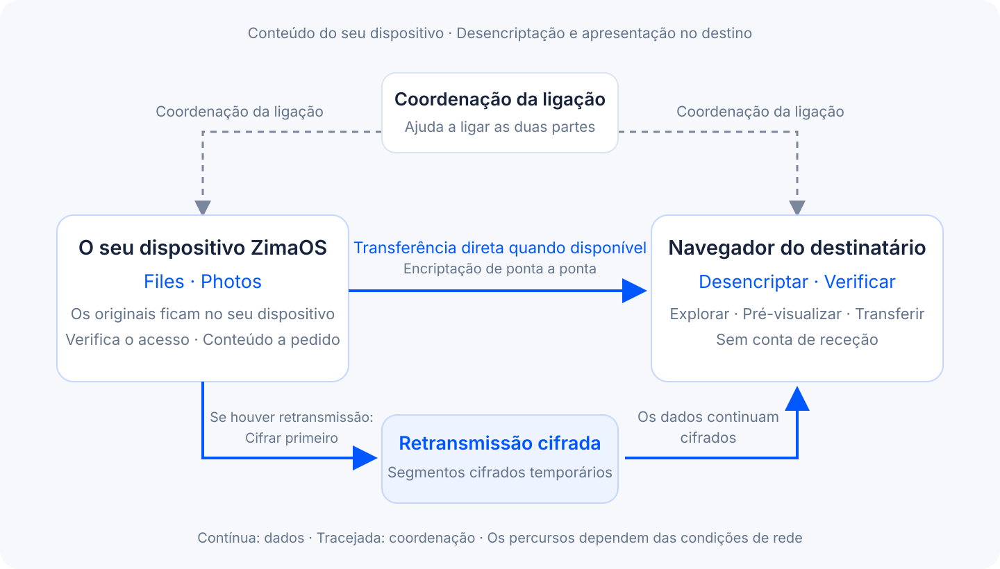

Envie materiais de um projeto a um colega, partilhe fotografias do fim de semana com a família ou mantenha um álbum atualizado. Crie uma ligação de partilha no ZimaOS e o destinatário pode ver e transferir o conteúdo num navegador, sem uma conta ZimaOS nem uma aplicação de receção dedicada.

O seu dispositivo ZimaOS continua a fornecer os ficheiros. Decide o que partilhar, se é necessária uma palavra-passe, quando a ligação expira e quando interromper a partilha.

## Escolha como partilhar

| O que pretende partilhar | Onde começar | Útil para |
| --- | --- | --- |
| Ficheiros, pastas ou um conjunto de documentos | Files | Entregar projetos, enviar documentos e partilhar uma pasta em atualização |
| Fotografias selecionadas | Photos | Destaques de viagens, fotografias de eventos e uma entrega pontual |
| Um álbum completo | Photos | Álbuns de família e um portefólio em atualização |

> **Antes de começar:** Mantenha o dispositivo ZimaOS ligado e com acesso à rede, com o disco ou armazenamento de origem acessível. Recomenda-se uma versão recente do Chrome, Edge, Safari ou Firefox para os destinatários. As capturas de ecrã usam conteúdo de demonstração, sem ligações de partilha de utilizadores reais. Os nomes dos elementos da interface podem variar com a versão e o idioma da aplicação; alguns exemplos apresentam a interface em inglês.

## Partilhe documentos a partir do Files

### Crie uma ligação

1. Abra o **Files** e selecione os ficheiros ou pastas que pretende partilhar.
2. Abra **Partilhar por ligação** e atribua um título fácil de reconhecer à partilha.
3. Defina uma palavra-passe de acesso, a validade e o histórico de visitas conforme necessário e selecione **Criar ligação de partilha**.
4. Copie a ligação gerada e envie-a ao destinatário. Se definiu uma palavra-passe, forneça-a também. Para materiais sensíveis, considere enviar a palavra-passe por outro canal.

*Janela de criação do Files. Confirme o conteúdo e as definições de acesso antes de enviar a ligação.*

### O que o destinatário vê

Depois de abrir a ligação, o destinatário pode explorar pastas, procurar ficheiros, alternar entre as vistas de lista e grelha e pré-visualizar os tipos de ficheiro suportados. Pode selecionar e transferir os ficheiros ou pastas de que necessita; vários itens podem ser transferidos num ficheiro compactado.

*Página de receção do Files: explore e pré-visualize primeiro e escolha depois o que pretende transferir.*

Quando partilha uma pasta, o conteúdo acompanha a pasta de origem. Depois de adicionar, remover ou alterar ficheiros, os destinatários podem atualizar a página para ver o conteúdo atual. Para entregar uma versão final de um projeto, organize-a numa pasta separada antes de a partilhar.

## Partilhe fotografias a partir do Photos

### Partilhe fotografias selecionadas ou um álbum completo

Selecione fotografias ou um álbum no **Photos** e use **Partilhar** para criar uma ligação. Defina um título, uma palavra-passe de acesso e a validade e copie a ligação para a enviar.

*Janela de criação do Photos. As seleções de fotografias e os álbuns usam as mesmas definições de partilha.*

A diferença está na forma como o conteúdo muda depois:

| Opção de partilha | O que acontece após a criação |
| --- | --- |
| Fotografias selecionadas | Partilha as fotografias selecionadas no momento da criação da ligação. As novas fotografias não são adicionadas automaticamente. Crie uma nova partilha para incluir mais fotografias. |
| Um álbum completo | Acompanha as alterações do álbum. As fotografias adicionadas posteriormente ao álbum também passam a fazer parte da partilha. |

### Permita que os destinatários explorem as fotografias de imediato

Ao abrir a ligação, o destinatário acede a uma página de fotografias. Pode alternar entre as disposições em grelha e em cascata, ajustar o tamanho de apresentação, abrir pré-visualizações maiores, iniciar uma apresentação de diapositivos e selecionar fotografias para transferir. As informações de captura disponíveis também podem ser consultadas a pedido nas fotografias compatíveis.

*A página de receção do Photos dá prioridade às fotografias. As miniaturas são carregadas conforme necessário; as pré-visualizações maiores são pedidas ao abri-las.*

*Explore, selecione e transfira também num telemóvel, sem instalar uma aplicação de receção.*

As pré-visualizações não substituem as fotografias originais no dispositivo. Ao transferir um original, o formato e o conteúdo do ficheiro de origem são preservados. A disponibilidade da pré-visualização depende do formato, das capacidades de processamento do dispositivo e do suporte do navegador.

## Mantenha o controlo das suas partilhas

### Palavras-passe e validade

Defina uma palavra-passe para conteúdo não público e escolha uma validade adequada à finalidade. As palavras-passe e a validade controlam os acessos posteriores. Os ficheiros já guardados no dispositivo de um destinatário não podem ser eliminados remotamente fazendo expirar a ligação.

### Gira, altere e interrompa partilhas

A gestão de partilhas permite consultar as partilhas existentes, alterar as definições disponíveis ou interromper a partilha. No Photos, também é possível distinguir seleções de fotografias de álbuns que se atualizam automaticamente.

*Seleções de fotografias e álbuns na gestão de partilhas. Regresse aqui para gerir as definições de acesso.*

Interromper uma partilha impede novos acessos através da respetiva ligação. Eliminar permanentemente um registo de partilha remove esse registo e mantém os ficheiros originais no dispositivo. Eliminar um álbum partilhado também invalida a sua partilha; esvaziar temporariamente o álbum não substitui automaticamente a ligação.

### Ative o histórico de visitas apenas quando precisar

O histórico de visitas está desativado por predefinição. Quando ativado, pode apresentar as horas das visitas, o tempo aproximado com a página em primeiro plano e um endereço IP de origem parcialmente oculto, quando este puder ser obtido de forma fiável. As origens indisponíveis aparecem como desconhecidas. Os registos são conservados durante 90 dias. Desativar o histórico interrompe a recolha de novos dados; os registos existentes expiram de acordo com o período de conservação.

Estas informações ajudam a compreender as visitas a uma partilha. Não permitem determinar de forma fiável a identidade de um destinatário, e o tempo na página não prova que um ficheiro foi lido na íntegra.

## Se uma ligação não abrir

| O que a página apresenta | O que fazer |
| --- | --- |
| Ligação inválida ou incompleta | Copie novamente a ligação completa da mensagem original. Se continuar incorreta, peça a quem partilhou que a envie de novo. |
| Partilha expirada ou indisponível | Peça a quem partilhou que prolongue a validade, confirme o estado ou forneça uma nova ligação. |
| Não é possível ligar ao dispositivo temporariamente | Verifique ambas as redes, confirme que o ZimaOS e o armazenamento de origem estão acessíveis e tente novamente. A partilha também pode ter sido interrompida. |
| Ligação antiga não suportada | Peça a quem partilhou que atualize o ZimaOS e as aplicações relevantes e crie uma nova ligação. |
| Falha na pré-visualização | Tente novamente ou transfira o original e abra-o numa aplicação adequada. |
| Transferência bloqueada num navegador integrado numa aplicação móvel | Abra a ligação num navegador independente, como o Safari ou o Chrome, e mantenha a página aberta até a transferência terminar. |

A página tenta restabelecer a ligação após uma interrupção temporária. Se for apresentada a opção **Continuar transferência**, siga essa indicação. A reutilização de dados recebidos depende do navegador, do armazenamento local e de eventuais alterações ao ficheiro de origem. Não pressuponha que todos os dispositivos conseguem retomar a transferência depois de fechar o separador.

## Mais pormenores: disponibilidade, desempenho e privacidade

A explicação seguinte descreve o funcionamento atual da partilha. Não precisa destes pormenores para a utilizar, mas ajudam a compreender o comportamento em diferentes condições de rede e os limites de segurança relevantes.

### Como os ficheiros chegam ao destinatário

*Uma visão funcional. As linhas contínuas representam os dados dos ficheiros e as tracejadas representam a coordenação da ligação. Ambos os percursos de dados são protegidos por encriptação de ponta a ponta; não estão necessariamente ativos ao mesmo tempo.*

**O seu dispositivo fornece o conteúdo e verifica o acesso.** O Files e o Photos têm pontos de entrada diferentes para a partilha. O serviço de partilha subjacente verifica o estado atual da partilha, as permissões e a versão dos ficheiros. Conhecer um identificador de ficheiro não concede permissão para o ler.

**O navegador recebe, verifica e apresenta o conteúdo.** Depois de autorizado o acesso, o navegador lê o conteúdo relevante, desencripta-o e apresenta-o no destino. As pré-visualizações, miniaturas e os dados transferidos também requerem autorização.

**Os serviços de rede ajudam a ligar as duas partes.** O sistema suporta transferências diretas do dispositivo para o navegador e transferências através de um intermediário cifrado. O percurso utilizado depende da rede e dos serviços disponíveis. A coordenação da ligação e a retransmissão têm responsabilidades diferentes.

### Disponibilidade: mais de uma forma de estabelecer a ligação

As ligações domésticas de banda larga, as redes móveis e as redes empresariais oferecem condições diferentes. O sistema pode iniciar o acesso por um percurso disponível enquanto verifica outros em segundo plano. Quando a ligação direta não está disponível, um intermediário cifrado pode assegurar a transferência. As falhas temporárias desencadeiam um número limitado de novas tentativas ou ajustes do percurso, com o estado e as ações de recuperação apresentados na página.

As transferências são divididas em segmentos. Uma falha recuperável não tem de invalidar todo o conteúdo já recebido. As versões de origem também são verificadas para evitar juntar incorretamente dados anteriores e posteriores a uma alteração do ficheiro.

Estes mecanismos melhoram a disponibilidade em redes com condições difíceis, mas não garantem uma ligação em todas as redes. O encerramento do dispositivo, a indisponibilidade do armazenamento de origem, uma partilha interrompida, permissões alteradas ou serviços de rede indisponíveis podem continuar a interromper o acesso. **Um intermediário cifrado não é uma unidade na nuvem que continua a fornecer ficheiros indefinidamente quando o seu dispositivo está offline.**

### Desempenho: apresente o conteúdo primeiro, transfira mais quando necessário

A navegação nas fotografias começa com miniaturas pequenas. Quando existem informações adequadas para um marcador de posição desfocado, este pode surgir antes da miniatura. As pré-visualizações mais nítidas e os pormenores de captura são obtidos conforme necessário, evitando transferir todos os originais apenas para explorar um álbum.

As listas extensas de ficheiros e as coleções de fotografias usam leituras por lotes e apresentação da área visível para reduzir o trabalho inicial. As miniaturas em cache podem ser reutilizadas, sujeitas à autorização atual e à verificação da versão do ficheiro. Uma pesquisa completa, a ordenação ou a abertura de pastas ainda não carregadas podem exigir leituras adicionais.

As transferências usam leituras paralelas limitadas e adequadas ao percurso. Quando as capacidades do navegador o permitem, os dados são escritos à medida que chegam. Isto ajuda a controlar a utilização da memória, para que um ficheiro grande não tenha de caber integralmente na memória. As formas de guardar e as permissões de armazenamento variam entre navegadores.

Como referência, os valores seguintes são velocidades médias de transferências completas de um único ficheiro em testes controlados. O tempo inclui a conclusão da gravação no navegador e o conteúdo dos ficheiros passou a validação. As unidades são MB/s decimais (1 MB = 1 000 000 bytes). São resultados de amostras, não picos instantâneos, limites fixos do produto ou velocidades garantidas em todos os ambientes. O tempo não inclui o estabelecimento da ligação nem a leitura do manifesto; a amostra de retransmissão foi medida com a ligação já preparada.

| Cenário de teste | Velocidade de referência de um ficheiro | Âmbito |
| --- | --- | --- |
| Ligação direta: teste local de envio e receção | Cerca de 191 MB/s | Apenas o desempenho do percurso de software local; não comprova o desempenho da rede física nem do disco do dispositivo |
| Retransmissão cifrada pela Internet | 62,58 MB/s | Uma transferência completa numa configuração de teste específica; os resultados variaram entre execuções |

A velocidade real depende da largura de banda de envio do dispositivo que partilha, da velocidade de leitura do disco, da rede do destinatário, do percurso de transferência e das capacidades do navegador. Os destinatários simultâneos competem pelos recursos do dispositivo e da rede; não formam automaticamente uma rede de distribuição em que reencaminham ficheiros entre si.

### Privacidade: proteja o conteúdo e compreenda os limites

**O conteúdo é encriptado e desencriptado nas duas extremidades.** As transferências diretas e através de intermediário usam encriptação de ponta a ponta. O intermediário recebe segmentos de dados cifrados em vez de ficheiros originais diretamente legíveis. A encriptação e a verificação de integridade trabalham em conjunto para proteger o conteúdo transferido.

**A retransmissão temporária não é alojamento público permanente.** Os segmentos cifrados estão sujeitos a mecanismos de autorização de acesso, validade e limpeza. A expiração do acesso e a eliminação física do armazenamento subjacente não ocorrem no mesmo instante; não pressuponha que todas as cópias desaparecem imediatamente.

**A encriptação do conteúdo não garante anonimato na rede.** A infraestrutura que estabelece ligações, fornece páginas ou retransmite dados pode continuar a processar informações de rede necessárias, como endereços IP e horas de ligação. Uma ligação válida é um ponto de acesso, e os destinatários podem guardar ou reencaminhar os ficheiros recebidos. Partilhe ligações e palavras-passe apenas com as pessoas pretendidas.

**O histórico de visitas e o diagnóstico da ligação são diferentes.** Quem partilha decide se ativa o histórico de visitas. Os diagnósticos da qualidade da ligação ajudam a melhorar a fiabilidade e as transferências através do registo do estado da ligação, tempos, velocidades e categorias de falha. Não incluem o conteúdo dos ficheiros, nomes de ficheiros, ligações de partilha, palavras-passe ou chaves de desencriptação.

**Os metadados das fotografias exigem atenção própria.** Os originais podem conter datas e horas de captura, localizações e outras informações. Carregar os pormenores de captura a pedido não remove automaticamente os metadados do original. Prepare uma cópia adequada antes de partilhar se não pretender que os destinatários recebam essas informações.

**Gira também os dados do navegador em dispositivos partilhados.** A cache de miniaturas e as transferências podem usar o armazenamento local do navegador. Num computador público, limpe os dados do sítio e os ficheiros transferidos conforme necessário após a utilização. Limpar os dados locais também pode afetar a reutilização da cache e a recuperação de transferências posteriores.

### Conformidade legal e isenção de responsabilidade

**Partilhe conteúdo de forma lícita e com os direitos necessários.** Ao utilizar a partilha por ligação, cumpra as leis e os regulamentos aplicáveis e certifique-se de que dispõe dos direitos ou da autorização necessários para partilhar o conteúdo. Não utilize esta funcionalidade para distribuir conteúdo ilícito nem para violar direitos de autor, de privacidade, de imagem ou outros direitos e interesses legítimos.

**A encriptação não substitui a autorização legal.** A encriptação de ponta a ponta, as palavras-passe de acesso e os prazos de validade protegem a transferência e controlam o acesso. Não significam que a legalidade do conteúdo partilhado tenha sido verificada nem que quem o partilha ou recebe tenha autorização para o utilizar, copiar ou redistribuir.

**Confirme o que partilha e quem irá receber o conteúdo.** Os destinatários podem guardar ou reencaminhar o conteúdo recebido. Parar uma partilha ou deixar expirar uma ligação não permite recuperar os ficheiros que os destinatários já tenham guardado. Obtenha a autorização necessária antes de partilhar informações pessoais, material confidencial ou conteúdo de terceiros.

**As partilhas ilícitas ou que violem direitos podem ser restringidas.** Se houver suspeitas de que o conteúdo partilhado é ilícito ou viola direitos de terceiros, o prestador do serviço pode restringir o acesso à ligação ou suspender o serviço de partilha correspondente, nos termos da legislação aplicável. Estas medidas afetam o acesso partilhado e não equivalem a eliminar os ficheiros originais do dispositivo.

**Cada parte responde nos termos da lei.** Quem partilha e quem recebe conteúdo é legalmente responsável pelos seus próprios atos de partilha, obtenção e utilização desse conteúdo. Este aviso não exclui nem limita as responsabilidades que o prestador do serviço deva assumir nos termos da legislação aplicável.

## Saiba mais

- [Conheça o ZimaOS Photos](./photos)
- [Consulte os formatos de fotografia suportados pelo Photos](./photos-supported-formats)
- [Visite a comunidade ZimaSpace para obter ajuda](https://community.zimaspace.com/)
