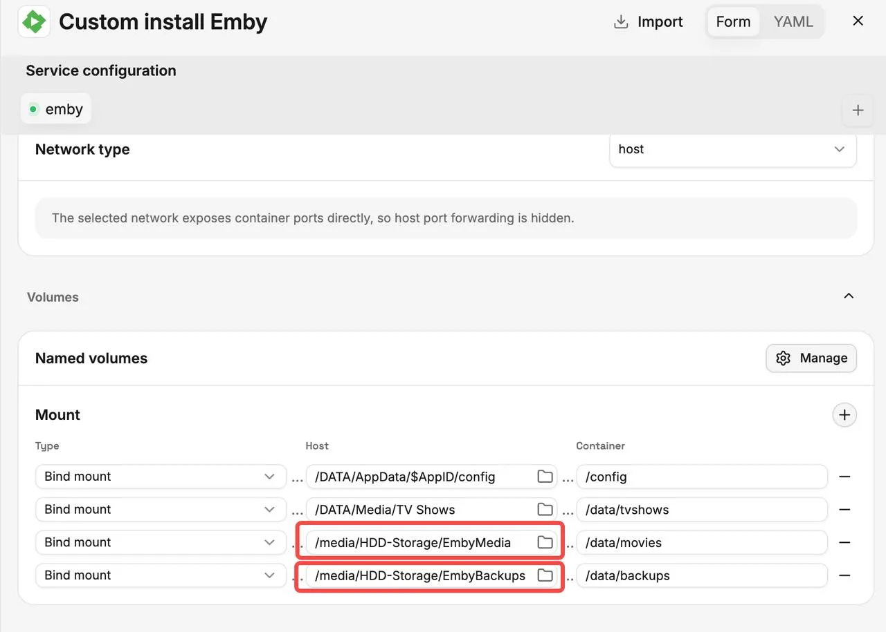
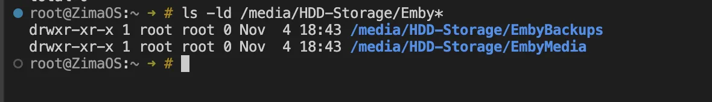
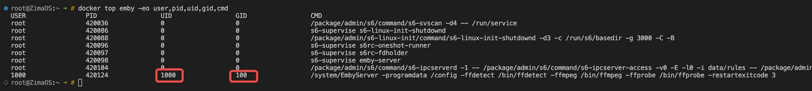

## 背景

在 ZimaOS 中将硬盘上的媒体或备份文件夹添加到 Emby 后，即使文件夹已经正确挂载，Emby 也可能只有读取权限。这通常是因为宿主机目录的所有权和权限没有向 Emby 使用的 UID/GID 授予写入权限。

本教程介绍如何确认 Emby 运行时使用的 UID/GID，并手动调整对应宿主机目录的权限。

## 本教程可以解决的问题

以下由写入权限不足引起的问题：

- Emby 可以读取和播放媒体，但无法将 NFO 文件、海报或其他元数据保存到媒体目录。
- Emby 无法写入指定的备份目录，导致备份失败。
- 访问或写入挂载目录时出现 `Permission denied` 错误。

## 如何修改权限

### 1. 找到需要修改的目录

进入 **Emby → Manage → Mount**。左侧的 **Host** 字段显示 ZimaOS 上的实际目录，右侧的 **Container** 字段显示 Emby 容器内部使用的路径。



如上图所示，需要修改的目录是：

```text
/media/HDD-Storage/EmbyMedia
/media/HDD-Storage/EmbyBackups
```

这里的“host”指这两个具体路径，而不是整个 AppData 或 Media 目录。



如图所示，**EmbyMedia** 和 **EmbyBackups** 均归 **root** 所有，权限为 **755**，这意味着只有 root 拥有写入权限。如果 Emby 以其他用户运行，就无法将 NFO 文件、海报或备份保存到这些目录。

### 2. 确认 Emby 使用的 UID/GID

在 **ZimaOS 宿主机终端或 SSH 会话**中运行以下命令：

```bash
docker ps
```

找到 Emby 容器名称，然后运行以下命令，将 `emby` 替换为实际名称：

```bash
docker top emby -eo user,pid,uid,gid,cmd
```

找到包含 `EmbyServer` 的进程，记下它的 UID 和 GID。



### 3. 修改目录所有权和写入权限

假设 Emby 的 UID 为 **1000**，GID 为 **100**，运行：

```bash
sudo chown -R 1000:100 "/media/HDD-Storage/EmbyMedia"
sudo chown -R 1000:100 "/media/HDD-Storage/EmbyBackups"

sudo chmod -R u+rwX "/media/HDD-Storage/EmbyMedia"
sudo chmod -R u+rwX "/media/HDD-Storage/EmbyBackups"
```

将 `1000:100` 替换为你查到的实际 UID/GID，并确保路径与你的 **Host** 配置一致。这些命令会修改两个目录及其所有内容的所有权和权限。如果其他应用也共享这些目录，还需要考虑它们的访问要求。

### 4. 在 Emby 中验证

再次尝试保存 NFO 文件、下载海报或运行备份。权限修改通常会立即生效，因此无需重新安装 Emby。
