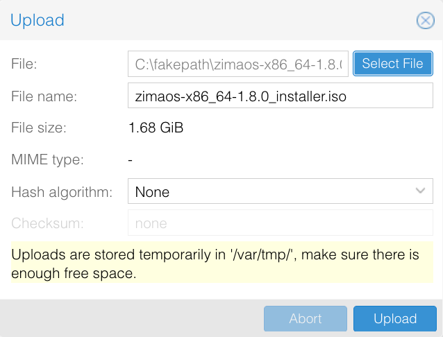

## 系统要求  
硬件和环境要求  
- 一个正在运行并可访问的Proxmox VE (PVE)环境  
- 启用了虚拟化支持的x86_64 CPU  
  推荐的最低配置：  
  - CPU：2核或更多（推荐4核）  
  - 内存：4GB或更多（推荐8GB）  
  - 存储：至少32GB的可用磁盘空间  

软件和系统要求  
- ZimaOS ISO安装镜像  
- Proxmox VE 6.x / 7.x / 8.x / 9.x  
- 虚拟机启动模式：UEFI  
- 虚拟机BIOS类型：OVMF (UEFI)

---

## 安装步骤

> Proxmox 截图中的版本号和存储名称仅为示例。

### 上传ZimaOS ISO镜像
1. 从 [ZimaOS GitHub Releases](https://github.com/IceWhaleTech/ZimaOS/releases) 下载 `_installer.iso` 文件。
2. 在 Proxmox VE 中选择节点及支持 ISO 的存储位置，例如 **local → ISO Images → Upload**。
3. 选择 ISO 文件，点击 **Upload**。

### 创建虚拟机
点击 **Create VM**，填写名称和 VM ID，并按下表配置。不同 Proxmox VE 版本的界面名称可能略有区别。

| 设置 | 配置 |
|---|---|
| OS | 选择已上传的 ZimaOS ISO，客户机操作系统类型选择 Linux |
| BIOS | **OVMF (UEFI)** |
| EFI 磁盘 | 启用 **Add EFI Disk** 并选择存储位置 |
| Secure Boot | 创建 EFI 磁盘时取消勾选 **Pre-Enroll keys** |
| 系统盘 | 至少 **32 GB**，使用 SCSI 磁盘和 VirtIO SCSI 控制器 |
| CPU | 至少 **2 个核心**，建议 4 个 |
| 内存 | 至少 **4096 MB**，建议 8192 MB |
| 网络 | 连接局域网的网桥，例如 `vmbr0`，使用 VirtIO 网络设备 |

EFI 磁盘用于保存固件设置，与安装 ZimaOS 的系统盘是两个不同的磁盘。请保持 Secure Boot 关闭。Proxmox 对 EFI 磁盘和预注册密钥的说明见 [BIOS and UEFI](https://pve.proxmox.com/pve-docs/chapter-qm.html#_bios_and_uefi)。

完成创建向导。在 **Options → Boot Order** 中启用虚拟 CD/DVD 驱动器供首次启动使用，同时保留系统盘作为可启动设备。

### 安装ZimaOS
1. 启动虚拟机并打开 **Console**，从已挂载的 ISO 启动。
2. 在 ZimaOS 图形安装程序的欢迎界面点击 **Start**，然后选择安装程序的语言。

3. 选择虚拟机的系统盘，点击 **Continue**。仔细核对容量：**所选磁盘上的全部数据都会被清除**。
4. 检查安装前的验证结果，点击 **Continue**。
5. 确认目标磁盘，点击 **Erase and install**。
6. 保持虚拟机运行，直到出现安装完成界面。图形界面的操作流程也可参照 [ZimaOS 安装指南](./how-to-install-zimaos)，虚拟机中的磁盘名称会有所不同。

### 移除ISO镜像
在安装完成界面点击重启之前：
1. 在 Proxmox VE 中打开虚拟机的 **Hardware** 页面。
2. 选择 **CD/DVD Drive**，点击 **Edit**，选择 **Do not use any media**，点击 **OK**。

3. 在 **Options → Boot Order** 中将已安装的系统盘放到第一位，保留 EFI 磁盘连接。
4. 返回 **Console**，在安装程序中点击 **Restart**。

### 启动并访问ZimaOS
从系统盘启动后，虚拟机控制台会显示 IP 地址。在能够访问虚拟机所在网络的电脑上，将该地址输入浏览器即可打开 ZimaOS。也可以使用同一网络中的 ZimaClient 连接。

如果又进入安装程序，请检查 ISO 是否已移除，以及系统盘是否位于启动顺序首位。如果 UEFI 提示安全验证失败，请确认 Secure Boot 已关闭。如果没有显示 IP，请检查虚拟机的网桥、虚拟网络设备和 DHCP 服务。

## 继续探索ZimaOS
参照 [ZimaOS 快速入门指南](./get-started)完成初始设置，开始管理存储和应用。
