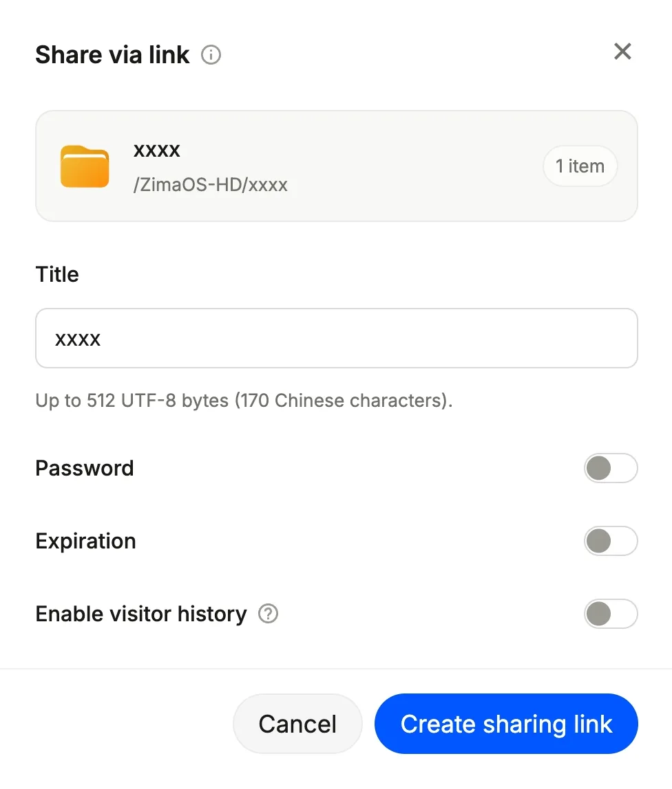
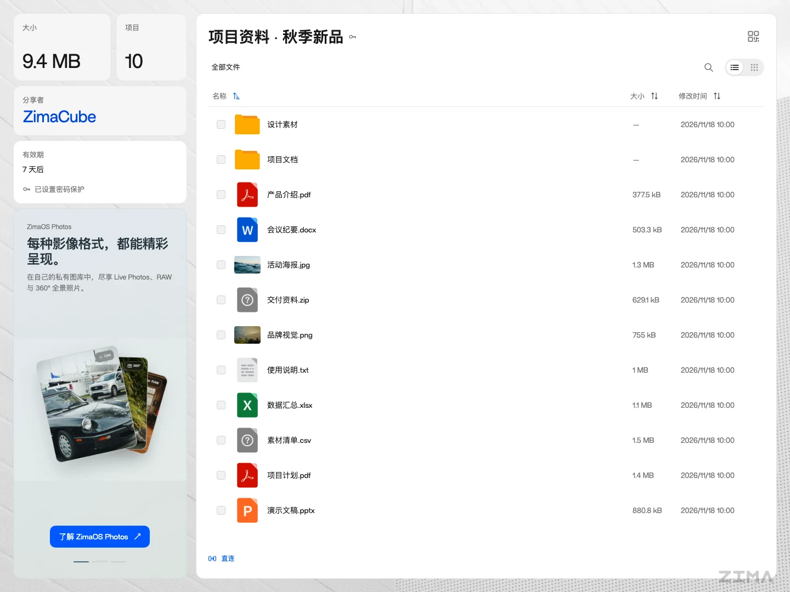
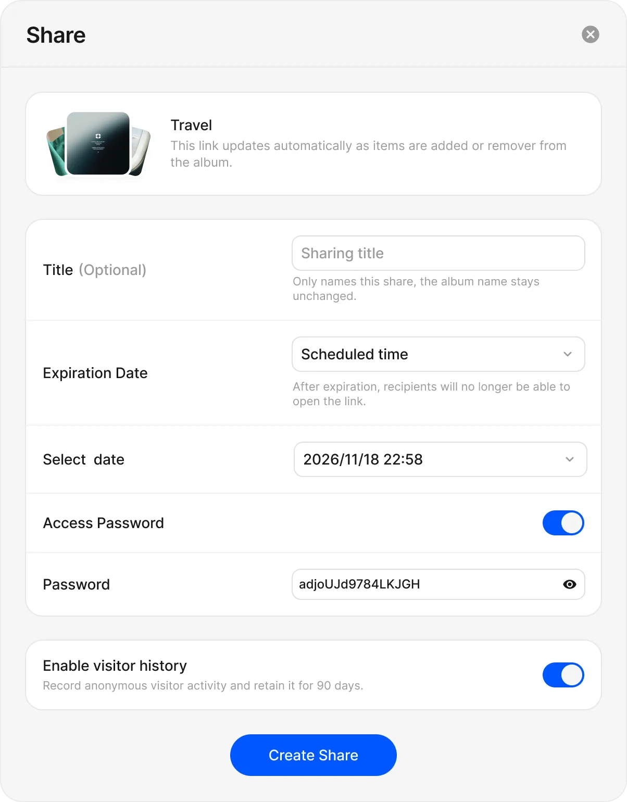
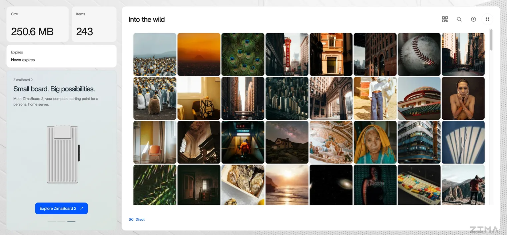
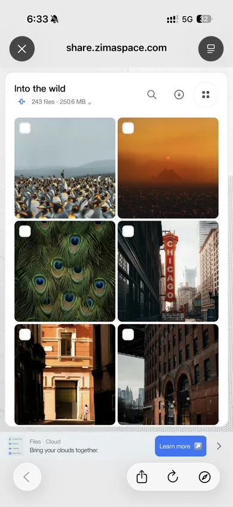
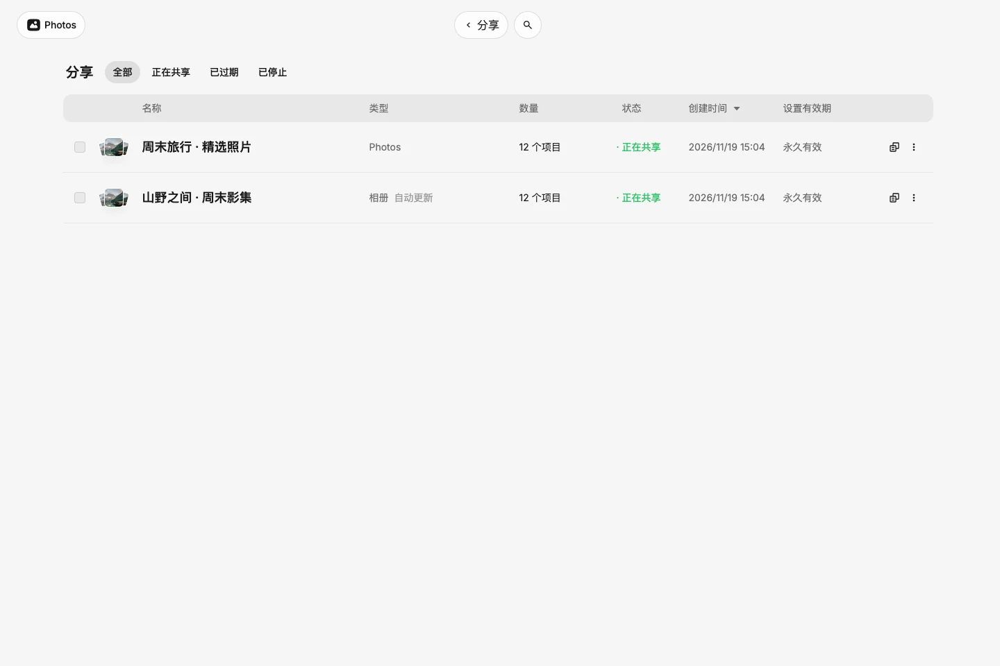
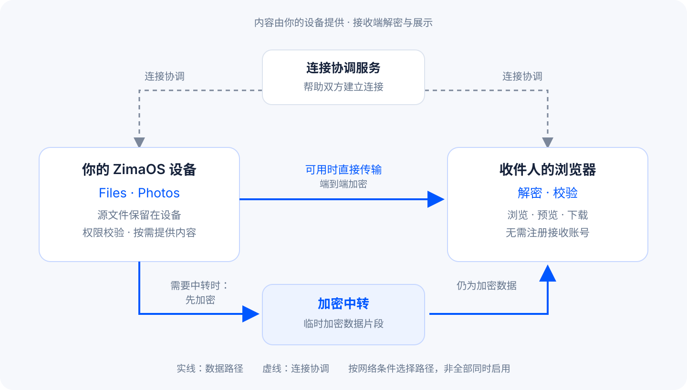

把项目资料发给同事，把周末的照片发给家人，或者持续更新一个相册——在 ZimaOS 中创建一个分享链接，对方就能通过浏览器查看和下载，无需注册 ZimaOS 账号，也无需安装专用接收应用。

文件仍由你的 ZimaOS 设备提供。你可以决定分享哪些内容、是否设置访问密码、链接何时到期，以及什么时候停止分享。

## 先选一种分享方式

| 你想分享的内容 | 从哪里开始 | 适合的场景 |
| --- | --- | --- |
| 文件、文件夹或一组资料 | Files | 交付项目资料、发送文档、共享持续更新的文件夹 |
| 挑选出的照片 | Photos | 旅行精选、活动照片、一次性交付 |
| 整个相册 | Photos | 家庭相册、持续更新的作品集 |

> **开始之前：** 请保持 ZimaOS 设备开机、联网，并确保分享的文件所在磁盘或存储可访问。收件人建议使用较新版本的 Chrome、Edge、Safari 或 Firefox。界面示例使用演示资料和照片，不包含真实用户的分享链接。界面名称可能随应用版本和语言变化，部分示例展示英文界面。

## 在 Files 中分享资料

### 创建链接

1. 打开 **Files**，选择要分享的文件或文件夹。
2. 打开 **通过链接共享**，为这份分享填写一个便于识别的标题。
3. 按需设置访问密码、有效期和访客记录，然后选择 **创建**。
4. 复制生成的链接，发送给收件人。如果设置了密码，也要把密码提供给对方；敏感资料建议通过另一种方式发送密码。

*Files 的创建窗口。发送前可以确认分享内容，并设置访问方式。*

### 收件人看到什么

打开链接后，对方可以浏览文件夹、搜索文件、切换列表或网格，并预览支持的文件类型。选中需要的文件或文件夹后即可下载；多项内容可以打包下载。

*Files 分享接收页：先浏览和预览，再选择需要下载的资料。*

分享文件夹时，内容会随源文件夹变化。新增、移除或修改文件后，收件人刷新即可查看当前内容。因此，若你要交付一份固定版本的资料，建议先整理到独立文件夹，再创建分享。

## 在 Photos 中分享照片

### 分享精选照片，或分享整个相册

在 **Photos** 中选中照片，或选中一个相册，再使用 **共享** 操作创建链接。设置标题、访问密码和有效期后，复制链接即可发送。

*Photos 的创建窗口。照片选集与相册使用相同的分享设置。*

两种方式的区别在于后续内容如何变化：

| 分享方式 | 创建后如何更新 |
| --- | --- |
| 精选照片 | 分享创建时选中的照片；新增照片不会自动加入。需要加入更多照片时，创建一个新的分享。 |
| 整个相册 | 分享跟随相册内容变化；以后加入相册的照片，也会进入这份分享。 |

### 让对方直接看照片

收件人打开链接后会进入照片浏览界面，可以在网格与瀑布流之间切换，调整显示大小、打开大图、播放幻灯片，并选择需要下载的照片。支持的照片还可以按需查看拍摄信息。

*Photos 分享接收页：照片优先展示，缩略图按需加载，打开后再查看大图。*

*手机上同样可以浏览、选择和下载，不需要安装接收应用。*

用于浏览的预览图不会覆盖设备上的原始照片。下载原始文件时，保留源文件本身的格式与内容；预览是否可用，取决于文件格式、设备处理能力和浏览器支持情况。

## 让分享保持在你的掌控中

### 访问密码与有效期

为非公开内容设置访问密码，并根据用途选择合适的有效期。密码和有效期控制后续访问；收件人已经保存到自己设备上的文件，不会因链接失效而被远程删除。

### 管理、修改和停止分享

在分享管理中，可以查看已有分享的状态、修改可用设置或停止分享。在 Photos 中，还可以区分精选照片与自动更新的相册。

*分享管理中的照片选集和相册。可以从这里继续管理访问设置。*

停止分享后，链接将不再提供后续访问。永久删除分享记录会移除对应记录，原始文件仍保留在设备中。删除被分享的相册也会使其分享失效；只是把相册暂时清空，不会自动换成另一条链接。

### 需要了解访问情况时，再开启访客记录

访客记录默认关闭。开启后，可以查看访问时间、大概的前台停留时长，以及能够可靠获取时的脱敏来源 IP；无法获取的来源显示为未知。记录保留 90 天，关闭后停止新增记录，已有记录按保留期限清理。

这类信息用于了解分享的访问情况，不能用来准确确认收件人的身份，也不能把访问时长当作文件已被完整阅读的证明。

## 链接打不开时，可以这样处理

| 页面情况 | 建议操作 |
| --- | --- |
| 链接无效或地址不完整 | 从原消息重新复制完整链接；仍不正确时，请分享者重新发送。 |
| 分享已过期或不可用 | 联系分享者延长有效期、确认分享状态，或获取新链接。 |
| 暂时无法连接设备 | 检查双方网络，并确认 ZimaOS 设备和源存储在线，然后重试。分享也可能已被停止。 |
| 旧版链接不受支持 | 请分享者更新 ZimaOS 和相关应用，然后重新创建链接。 |
| 预览失败 | 尝试重新预览，或下载原始文件后用合适的应用打开。 |
| 手机内嵌浏览器无法下载 | 在 Safari、Chrome 等独立浏览器中打开链接，并保留页面直至下载完成。 |

短暂断线时，页面会尝试恢复连接。出现 **继续下载** 操作时，可按提示继续；能否复用已经接收的数据，取决于浏览器、本地存储和源文件是否发生变化。不要把关闭标签页后的恢复能力当作所有设备都具备的保证。

## 进一步了解：可用性、性能与隐私

下面介绍当前分享能力的工作方式。你不需要了解这些技术细节就能使用分享；它们有助于理解不同网络条件下的表现和安全边界。

### 一张图看懂文件如何到达收件人

*这是功能层面的示意图。实线表示文件数据路径，虚线表示连接协调；两种数据路径都受端到端加密保护，不代表所有路径会同时启用。*

**你的设备负责提供内容和检查权限。** Files 与 Photos 提供不同的分享入口，底层分享能力会校验当前分享状态、文件访问权限和文件版本。知道一个文件编号，不等于获得该文件的读取权限。

**浏览器负责接收、校验和展示。** 收件人获得有效访问权限后，浏览器才读取相应内容，并在接收端解密和显示。预览图、缩略图和下载的数据同样需要经过授权。

**网络服务帮助连接双方。** 系统支持设备与浏览器之间的直接传输，也支持加密中转。采用哪条路径，取决于当前网络和可用服务；连接服务与中转服务承担的职责不同。

### 可用性：连接不止一种方式

家庭宽带、移动网络和企业网络的连接条件并不相同。系统可以先使用当前可用的路径建立访问，并在后台探测其他可用路径；直连不可用时，可通过加密中转继续传输。临时失败会触发有界重试或路径调整，页面也提供相应的状态与恢复操作。

传输以分段方式进行。可恢复的失败不必等同于整份内容作废；同时，系统会检查源文件版本，避免把变更前后的数据错误拼接成同一个文件。

这些机制提升了复杂网络下的可用性，但不能保证任意网络都能连接。设备关机、源存储离线、分享已停止、权限变化或网络服务不可用，仍可能使访问中断。**加密中转也不等于设备离线后仍能长期提供文件的云盘。**

### 性能：先看到内容，再按需要传输

照片浏览首先使用小尺寸缩略图；有合适的模糊占位信息时，可以先显示占位，再替换为清晰小图。更清晰的预览和拍摄详情在需要时获取，避免为了浏览相册就传输全部原图。

大型文件列表和照片集采用分批读取与可视区域渲染，减少初次打开时需要处理的内容。缓存可以复用已获取的缩略图，但仍受当前授权和文件版本约束。完整搜索、排序或访问尚未加载的目录时，可能需要额外读取。

下载会根据路径条件安排有界的并发读取，并在浏览器能力允许时边接收边写入；这有助于控制内存使用，也让大文件不必全部驻留在内存里。不同浏览器的保存方式和存储权限存在差异。

以下为受控测试中完整单文件传输的平均速度参考，包含浏览器保存完成，文件内容校验通过。单位为十进制 MB/s（1 MB = 1,000,000 字节），不代表瞬时峰值、产品固定上限或任意环境下的速度承诺。建连和清单读取不计入上述计时，中继样本在连接预热后测得。

| 测试场景 | 单文件参考速度 | 测试范围 |
| --- | --- | --- |
| 直连：本地收发测试 | 约 191 MB/s | 仅反映本机软件链路吞吐，不等同于真实网络或设备磁盘性能 |
| 公网加密中继 | 62.58 MB/s | 特定测试配置下的完整文件样本，多轮结果仍有波动 |

实际速度仍取决于分享设备的上行带宽、磁盘读取速度、收件人网络、传输路径和浏览器能力。多位收件人同时下载时，会竞争设备和网络资源；收件人之间不会因此自动组成一个互相分发文件的下载网络。

### 隐私：保护内容，也说明必要的边界

**文件内容在传输两端加密和解密。** 直接传输与加密中转都使用端到端加密。需要中转时，中转服务接收的是加密数据片段，而不是可直接浏览的原始文件；加密与完整性校验共同保护传输内容。

**临时中转不是永久公开发布。** 加密片段受访问授权与有效期约束，并有清理机制。访问失效和底层存储的物理删除不是同一时刻，不能将其理解为所有副本会立即消失。

**内容加密不等于网络匿名。** 建立连接、提供网页和执行中转的基础设施仍可能处理 IP 地址、连接时间等必要网络信息。有效链接本身也是访问入口，收件人获得文件后仍能保存或转发。因此，请仅向合适的人发送链接和密码。

**访问记录与连接质量诊断是不同的数据。** 访客记录由分享者选择是否开启；连接质量诊断用于改进连接稳定性和传输体验，记录连接状态、耗时、速率和失败类别等信息，不包含文件正文、文件名、分享链接、密码或解密密钥。

**照片元数据需要单独留意。** 原始照片可能包含拍摄时间、位置等信息。按需加载拍摄详情并不代表自动清除了原图的元数据；如果不希望向收件人提供这些信息，应在分享前处理准备公开的副本。

**共享设备上的浏览器也需要管理。** 缩略图缓存和下载过程可能使用浏览器本地存储。在公共电脑上使用后，可按需要清理站点数据与已下载文件；清理本地数据也可能影响后续缓存复用和下载恢复。

### 法律合规与免责声明

**请合法且有权地分享内容。** 使用链接分享功能时，请遵守适用法律法规，并确保你拥有分享相关内容的权利或必要授权。不得利用本功能传播违法内容，或侵犯他人的著作权、隐私权、肖像权及其他合法权益。

**加密保护不替代合法授权。** 端到端加密、访问密码和有效期用于保护传输及控制访问，不代表分享内容已经过合法性审查，也不代表分享者或接收者已获得使用、复制或再次传播内容的授权。

**发送前，请确认分享范围和接收对象。** 接收者可能保存或转发已获取的内容。停止分享或链接到期，不能撤回接收者已经保存的文件。涉及个人信息、保密资料或第三方内容时，请事先取得必要授权。

**违规分享可能受到限制。** 对涉嫌违法或侵权的分享，服务提供方可依法限制链接访问或停止相关分享服务。此类措施针对分享访问，不等同于删除设备上的原始文件。

**各方应依法承担相应责任。** 分享者和接收者应对各自的分享、获取及使用行为依法负责。本说明不免除或限制服务提供方依法应承担的责任。

## 继续探索

- [了解 ZimaOS Photos](./photos)
- [查看 Photos 支持的照片格式](./photos-supported-formats)
- [访问 ZimaSpace 社区，获取使用帮助](https://community.zimaspace.com/)
