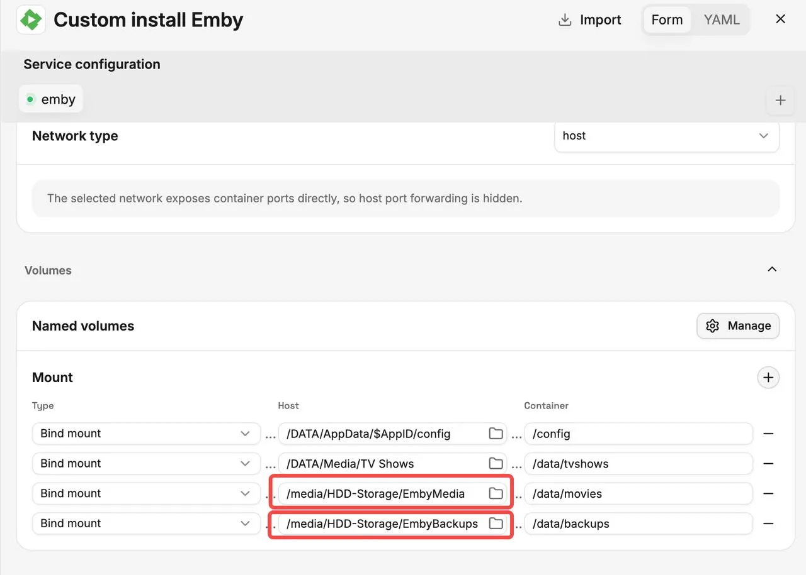
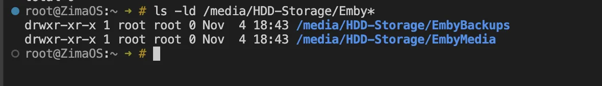
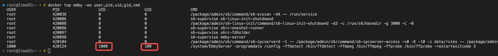

## Background

After adding media or backup folders from a hard drive to Emby in ZimaOS, Emby may only have read access, even when the folders are mounted correctly. This usually happens when the host directory's ownership and permissions do not grant write access to the UID/GID used by Emby.

This tutorial explains how to identify the UID/GID Emby runs under and manually adjust permissions on the corresponding host directories.

## What This Tutorial Helps Resolve

The following issues caused by insufficient write permissions:

- Emby can read and play media but cannot save NFO files, posters, or other metadata to the media directory.
- Backups fail because Emby cannot write to the specified backup directory.
- A `Permission denied` error appears when accessing or writing to mounted directories.

## How to Change the Permissions

### 1. Find the Directory to Modify

Go to **Emby → Manage → Mount**. The **Host** field on the left shows the actual directory on ZimaOS, while the **Container** field on the right shows the path used inside the Emby container.



As shown in the screenshot above, the directories to modify are:

```text
/media/HDD-Storage/EmbyMedia
/media/HDD-Storage/EmbyBackups
```

Here, "host" refers to these two specific paths, not the entire AppData or Media directory.



As shown in the screenshot, both **EmbyMedia** and **EmbyBackups** are owned by **root** with **755** permissions, meaning only root has write access. If Emby runs as a different user, it cannot save NFO files, posters, or backups to these directories.

### 2. Identify the UID/GID Used by Emby

Run the following command in the **ZimaOS host terminal or an SSH session**:

```bash
docker ps
```

Find the Emby container name, then run the following command, replacing `emby` with the actual name:

```bash
docker top emby -eo user,pid,uid,gid,cmd
```

Locate the process containing `EmbyServer` and note its UID and GID.



### 3. Change Directory Ownership and Write Permissions

Assuming Emby's UID is **1000** and GID is **100**, run:

```bash
sudo chown -R 1000:100 "/media/HDD-Storage/EmbyMedia"
sudo chown -R 1000:100 "/media/HDD-Storage/EmbyBackups"

sudo chmod -R u+rwX "/media/HDD-Storage/EmbyMedia"
sudo chmod -R u+rwX "/media/HDD-Storage/EmbyBackups"
```

Replace `1000:100` with the actual UID/GID you found, and ensure the paths match your **Host** configuration. These commands change ownership and permissions for both directories and their contents. If other applications share these directories, consider their access requirements as well.

### 4. Verify in Emby

Try saving NFO files, downloading posters, or running a backup again. Permission changes usually take effect immediately, so there is no need to reinstall Emby.
