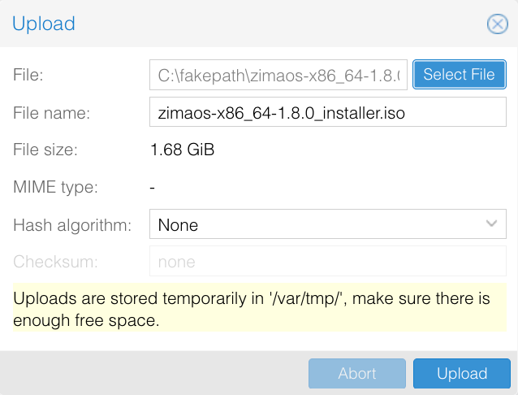

**W**ith the official release of the **ZimaOS ISO image** , you can now install and deploy ZimaOS more easily in virtualized environments such as **Proxmox VE (PVE)** .
 This ISO image is **specifically optimized for virtual machine installation**, allowing you to deploy ZimaOS without physical hardware and quickly explore its core features.
This installation method is ideal for **testing, learning, evaluation, and lightweight usage scenarios**.

## Introduction
Installing ZimaOS on Proxmox VE (PVE) means running ZimaOS as a **virtual machine using an ISO image**, rather than installing it directly on physical hardware. This approach allows you to experience the full ZimaOS system and web-based management interface within a standard virtualization environment.
By deploying ZimaOS on PVE, you can quickly create an isolated ZimaOS instance on your existing server or homelab. Compared to bare-metal installation, this method offers several advantages:
- Faster setup with a lower learning curve
- Reduced risk compared to direct hardware installation
- Easy environment replication with snapshots and backups
- Flexible resource allocation (CPU, memory, storage)
It is especially suitable for **feature evaluation, solution validation, and lightweight service deployment**.
---

## Requirements
Hardware & Environment Requirements
- A working and accessible Proxmox VE (PVE) environment
- An x86_64 CPU with virtualization support enabled
  Recommended minimum configuration:
  - CPU: 2 cores or more (4 cores recommended)
  - Memory: 4 GB or more (8 GB recommended)
  - Storage: At least 32 GB of available disk space

Software & System Requirements
- ZimaOS ISO installation image
- Proxmox VE 6.x / 7.x / 8.x / 9.x
- Virtual machine boot mode: UEFI
- VM BIOS type: OVMF (UEFI)

---
## Installation Steps

> Version numbers and storage names in the Proxmox screenshots are examples.

### Upload the ZimaOS ISO Image
1. Download the `_installer.iso` file from [ZimaOS GitHub Releases](https://github.com/IceWhaleTech/ZimaOS/releases).
2. In Proxmox VE, select the node and an ISO-enabled storage location, such as **local → ISO Images → Upload**.
3. Select the ISO file and click **Upload**.

### Create a Virtual Machine
Click **Create VM**, assign a name and VM ID, and configure the following settings. Interface labels may vary between Proxmox VE versions.

| Setting | Value |
|---|---|
| OS | Select the uploaded ZimaOS ISO; guest OS type Linux |
| BIOS | **OVMF (UEFI)** |
| EFI disk | Enable **Add EFI Disk** and select its storage |
| Secure Boot | Clear **Pre-Enroll keys** when creating the EFI disk |
| System disk | At least **32 GB**, using a SCSI disk and VirtIO SCSI controller |
| CPU | At least **2 cores**; 4 recommended |
| Memory | At least **4096 MB**; 8192 MB recommended |
| Network | A bridge connected to your LAN, such as `vmbr0`, with a VirtIO network device |

The EFI disk stores firmware settings; it is separate from the system disk where ZimaOS is installed. Keep Secure Boot disabled. Proxmox documents EFI disks and pre-enrolled keys in [BIOS and UEFI](https://pve.proxmox.com/pve-docs/chapter-qm.html#_bios_and_uefi).

Finish the wizard. Under **Options → Boot Order**, enable the virtual CD/DVD drive for the first boot and keep the system disk available as a boot device.

### Install ZimaOS
1. Start the VM and open **Console**. Boot from the attached ISO.
2. On the graphical ZimaOS Installer welcome screen, click **Start** and select the installer language.

3. Select the VM's system disk and click **Continue**. Check the capacity: **all data on the selected disk will be erased**.
4. Review the installation checks and click **Continue**.
5. Confirm the target disk and click **Erase and install**.
6. Keep the VM running until the installation complete screen appears. The graphical screens are also shown in the [ZimaOS installation guide](./how-to-install-zimaos); disk names in a VM will differ.

### Remove the ISO Image
Before restarting from the completion screen:
1. Open the VM's **Hardware** tab in Proxmox VE.
2. Select the **CD/DVD Drive**, click **Edit**, choose **Do not use any media**, and click **OK**.

3. Under **Options → Boot Order**, place the installed system disk first. Keep the EFI disk attached.
4. Return to **Console** and click **Restart** in the installer.

### Start and Access ZimaOS
After booting from the system disk, the VM console displays its IP address. From a computer that can reach the VM's network, enter that address in a browser to open ZimaOS. You can also use ZimaClient on the same network.

If the installer appears again, check that the ISO is detached and the system disk is first in the boot order. If UEFI reports a security violation, check that Secure Boot is disabled. If no IP appears, check the VM's network bridge, virtual network device, and DHCP service.

## Continue Exploring ZimaOS
Follow [Get Started with ZimaOS](./get-started) to complete initial setup and begin managing storage and applications.
