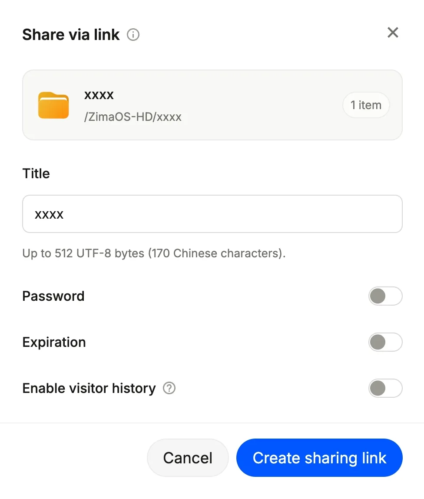
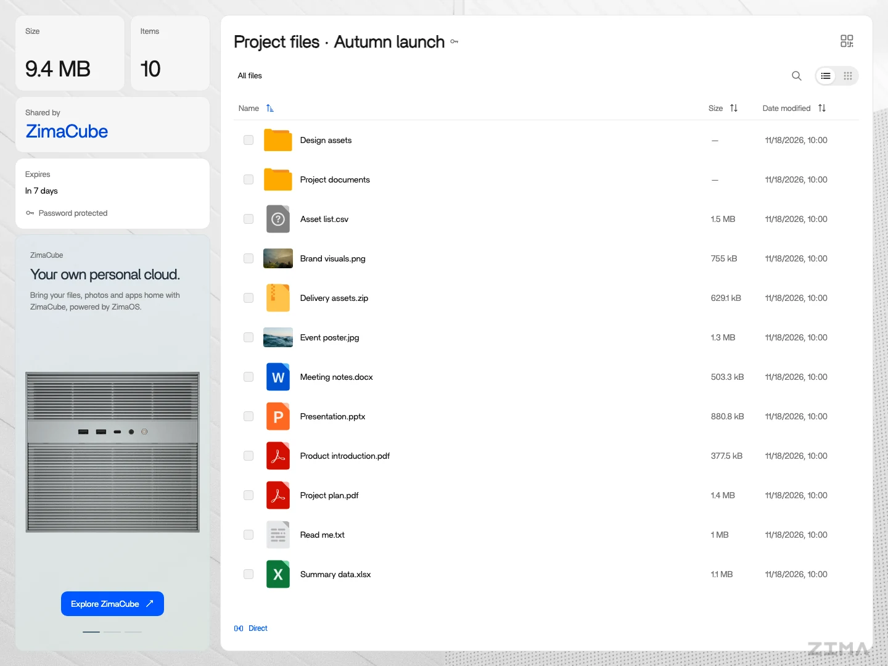
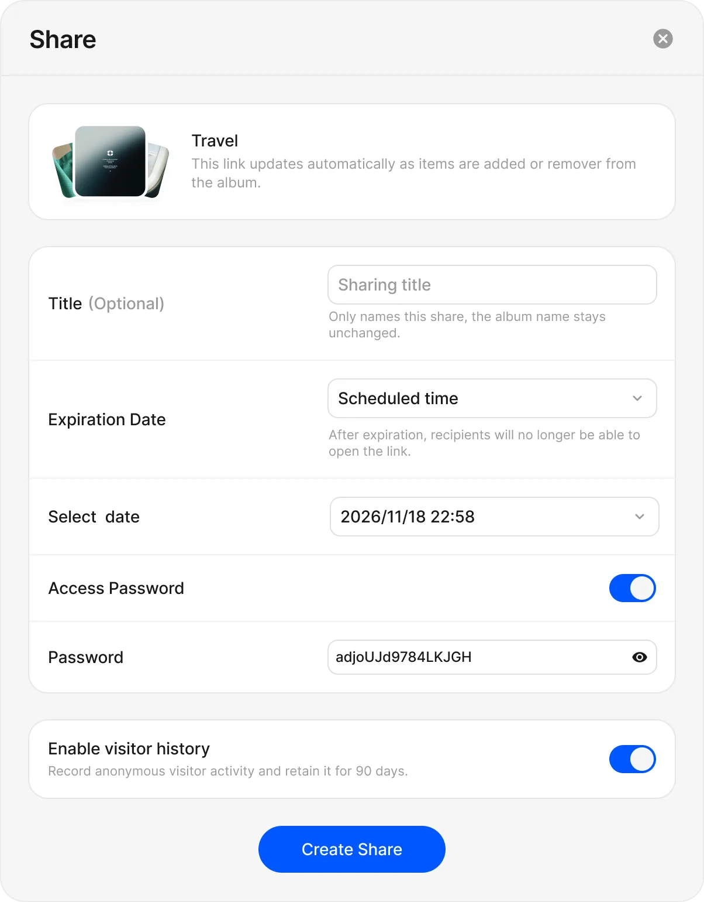
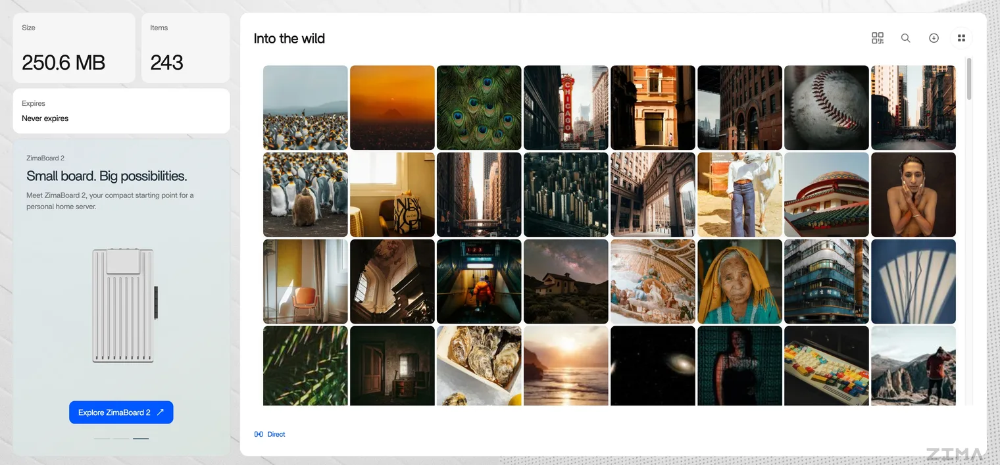
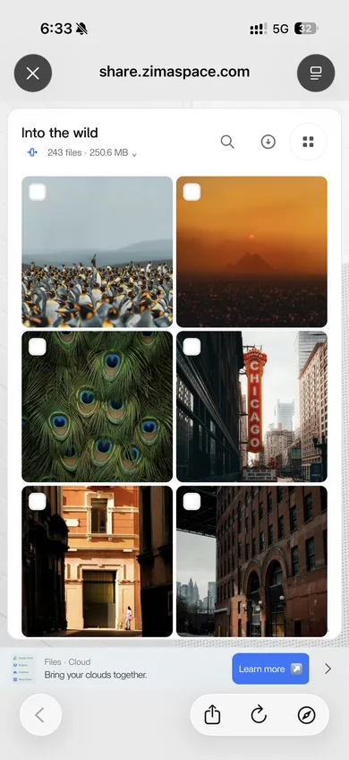
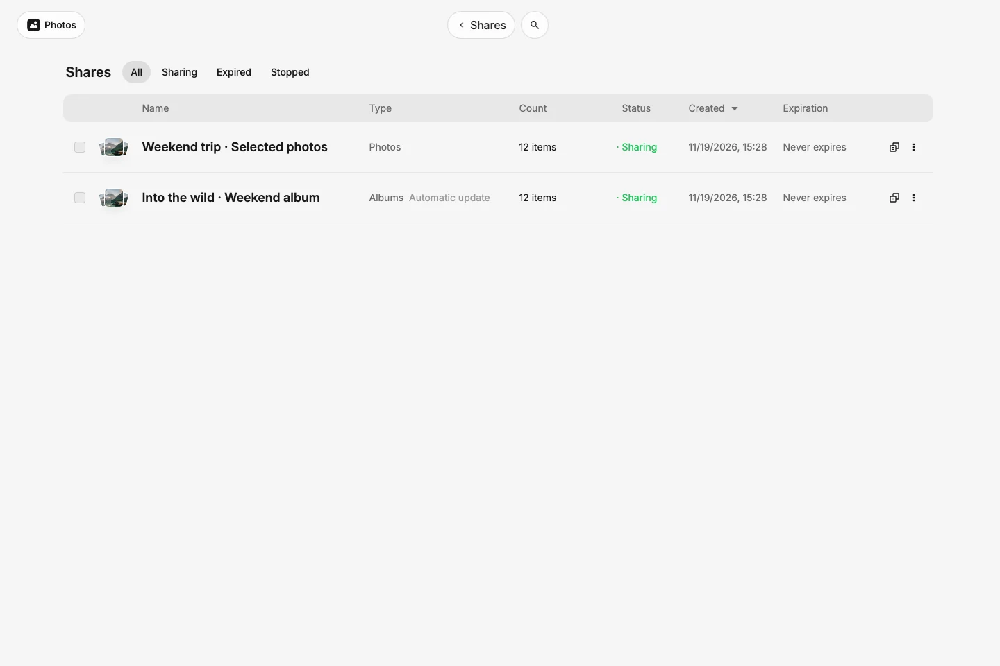
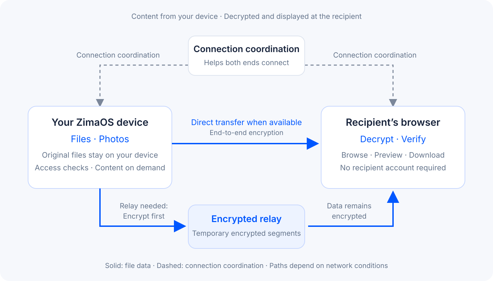

Send project materials to a colleague, share weekend photos with family, or keep an album up to date. Create a share link in ZimaOS and the recipient can view and download its contents in a browser, without a ZimaOS account or a dedicated receiving app.

Your ZimaOS device continues to provide the files. You decide what to share, whether to require a password, when the link expires and when to stop sharing.

## Choose how to share

| What you want to share | Start in | Useful for |
| --- | --- | --- |
| Files, folders or a set of documents | Files | Project handovers, sending documents and sharing an evolving folder |
| Selected photos | Photos | Travel highlights, event photos and a one-off delivery |
| An entire album | Photos | Family albums and an evolving portfolio |

> **Before you begin:** Keep the ZimaOS device powered on and connected, with the source disk or storage accessible. Recipients should use a recent version of Chrome, Edge, Safari or Firefox. Screenshots use demonstration content, without real users' share links. Interface labels can vary with the application version and language; some examples show English labels.

## Share documents from Files

### Create a link

1. Open **Files** and select the files or folders you want to share.
2. Open **Share via link** and give the share a recognizable title.
3. Set an access password, expiry and visitor history as needed, then select **Create sharing link**.
4. Copy the generated link and send it to the recipient. If you set a password, provide it too. For sensitive material, consider sending the password through a different channel.

*The Files creation dialog. Check the shared content and access settings before sending the link.*

### What the recipient sees

After opening the link, recipients can browse folders, search files, switch between list and grid views, and preview supported file types. They can select the files or folders they need and download them; multiple items can be downloaded as an archive.

*The Files receiving page: browse and preview first, then choose what to download.*

When you share a folder, its contents follow the source folder. After files are added, removed or changed, recipients can refresh to see the current content. For a fixed project handover, organize the final version in a separate folder before sharing it.

## Share photos from Photos

### Share selected photos or an entire album

Select photos or an album in **Photos**, then use **Share** to create a link. Set a title, access password and expiry, then copy the link to send it.

*The Photos creation dialog. Photo selections and albums use the same sharing settings.*

The difference is how the content changes later:

| Sharing option | What happens after creation |
| --- | --- |
| Selected photos | Shares the photos selected when the link is created. New photos are not added automatically. Create a new share to include more photos. |
| An entire album | Follows changes to the album. Photos added to the album later also become part of the share. |

### Let recipients browse photos immediately

Opening the link takes recipients to a photo browsing page. They can switch between grid and waterfall views, adjust the display size, open larger previews, run a slideshow and select photos to download. Available shooting information can also be viewed on demand for supported photos.

*The Photos receiving page puts photos first. Thumbnails load as needed; larger previews are requested when opened.*

*Browse, select and download on a phone too, without installing a receiving app.*

Browsing previews do not overwrite the original photos on the device. Downloading an original preserves the source file's format and content. Preview availability depends on the format, the device's processing capabilities and browser support.

## Keep control of your shares

### Passwords and expiry

Set a password for non-public content and choose an expiry appropriate to its purpose. Passwords and expiry control subsequent access. Files already saved to a recipient's device cannot be remotely deleted by making the link expire.

### Manage, change and stop shares

Share management lets you check existing shares, change available settings or stop sharing. In Photos, you can also distinguish photo selections from automatically updating albums.

*Photo selections and albums in share management. Return here to manage access settings.*

Stopping a share prevents further access through its link. Permanently deleting a share record removes that record while leaving the original files on the device. Deleting a shared album also invalidates its share; temporarily emptying the album does not automatically replace its link.

### Enable visitor history only when you need it

Visitor history is off by default. When enabled, it can show visit times, approximate time spent with the page in the foreground, and a masked source IP address when one can be obtained reliably. Unavailable sources appear as unknown. Records are retained for 90 days. Turning history off stops new collection; existing records expire according to the retention period.

This information helps you understand visits to a share. It cannot reliably establish a recipient's identity, and time spent on the page is not proof that a file has been read in full.

## If a link does not open

| What the page shows | What to do |
| --- | --- |
| Invalid or incomplete link | Copy the complete link again from the original message. If it is still incorrect, ask the sharer to resend it. |
| Share expired or unavailable | Ask the sharer to extend its expiry, confirm its status or provide a new link. |
| Temporarily unable to connect to the device | Check both networks, confirm that ZimaOS and its source storage are online, then retry. The share may also have been stopped. |
| Unsupported older link | Ask the sharer to update ZimaOS and the relevant applications, then create a new link. |
| Preview failed | Retry the preview, or download the original and open it in a suitable application. |
| Download blocked in an embedded mobile browser | Open the link in a standalone browser such as Safari or Chrome and keep the page open until the download completes. |

The page attempts to reconnect after a temporary disconnection. If **Continue download** is offered, follow that prompt. Reusing received data depends on the browser, local storage and whether the source file has changed. Do not assume every device can resume after the tab is closed.

## A closer look: availability, performance and privacy

The following explains how current sharing works. You do not need these details to use it, but they help explain behavior under different network conditions and the relevant security boundaries.

### How files reach the recipient

*A functional overview. Solid lines represent file data and dashed lines represent connection coordination. Both data paths are protected by end-to-end encryption; they are not necessarily active at the same time.*

**Your device provides content and checks access.** Files and Photos have different sharing entry points. The underlying sharing service checks the share's current status, file permissions and file version. Knowing a file identifier does not grant permission to read it.

**The browser receives, verifies and displays content.** Once access is authorized, the browser reads the relevant content, decrypts it and displays it at the receiving end. Previews, thumbnails and downloaded data all require authorization too.

**Network services help connect both ends.** The system supports direct device-to-browser transfers and encrypted relay transfers. The path used depends on the network and available services. Connection coordination and relaying have different responsibilities.

### Availability: more than one way to connect

Home broadband, mobile networks and corporate networks have different connection conditions. The system can start access over an available path while probing other paths in the background. When direct connectivity is unavailable, an encrypted relay can carry the transfer. Temporary failures trigger bounded retries or path adjustments, with status and recovery actions shown on the page.

Transfers are split into segments. A recoverable failure need not invalidate all received content. Source versions are also checked to avoid incorrectly joining data from before and after a file changes.

These mechanisms improve availability across challenging networks, but cannot guarantee a connection on every network. Device shutdown, unavailable source storage, a stopped share, changed permissions or unavailable network services can still interrupt access. **An encrypted relay is not a cloud drive that keeps serving files indefinitely while your device is offline.**

### Performance: show content first, transfer more when needed

Photo browsing starts with small thumbnails. When suitable blurred placeholder information is available, a placeholder can appear before the thumbnail. Clearer previews and shooting details are fetched when needed, avoiding transfers of every original just to browse an album.

Large file lists and photo collections use batched reads and visible-area rendering to reduce the initial workload. Cached thumbnails can be reused, subject to current authorization and file-version checks. A complete search, sorting or opening unloaded folders may require additional reads.

Downloads use bounded parallel reads appropriate to the path. Where browser capabilities allow, data is written as it arrives. This helps control memory usage, so a large file need not fit entirely in memory. Save methods and storage permissions vary between browsers.

For context, the following are average rates for complete single-file transfers in controlled tests. Timing includes browser save completion, and file contents passed validation. Rates use decimal MB/s (1 MB = 1,000,000 bytes). These are sample observations, rather than instantaneous peaks, fixed product limits or promised rates for every environment. Connection establishment and manifest reads are outside the timer; the relay sample used a warmed connection.

| Test scenario | Single-file reference rate | Scope |
| --- | --- | --- |
| Direct: local send-and-receive test | About 191 MB/s | Local software-path throughput only; does not establish physical-network or device-disk performance |
| Public encrypted relay | 62.58 MB/s | A complete-file sample under a specific test configuration; repeated runs still varied |

Actual speed depends on the sharing device's upload bandwidth, disk read speed, the recipient's network, the transfer path and browser capabilities. Concurrent recipients compete for device and network resources; they do not automatically form a peer distribution network that forwards files to one another.

### Privacy: protect content and explain the boundaries

**Content is encrypted and decrypted at the two ends.** Direct and relay transfers both use end-to-end encryption. A relay receives encrypted data segments rather than directly readable original files. Encryption and integrity verification work together to protect transferred content.

**Temporary relaying is not permanent public hosting.** Encrypted segments are subject to access authorization, expiry and cleanup mechanisms. Access expiry and physical deletion from underlying storage do not occur at the same instant; do not assume every copy disappears immediately.

**Content encryption does not provide network anonymity.** Infrastructure that establishes connections, serves pages or relays data may still process necessary network information such as IP addresses and connection times. A valid link is an access entry point, and recipients can save or forward received files. Share links and passwords only with the intended people.

**Visitor history and connection diagnostics are different.** The sharer chooses whether to enable visitor history. Connection-quality diagnostics help improve reliability and transfer behavior by recording connection state, timings, rates and failure categories. They do not include file contents, filenames, share links, passwords or decryption keys.

**Photo metadata needs separate consideration.** Originals may contain capture times, locations and other information. Loading shooting details on demand does not automatically remove metadata from the original. Prepare a suitable copy before sharing if you do not want recipients to receive that information.

**Manage browser data on shared devices too.** Thumbnail caching and downloads may use local browser storage. On a public computer, clear site data and downloaded files as appropriate after use. Clearing local data can also affect later cache reuse and download recovery.

### Legal compliance and disclaimer

**Share content lawfully and with the necessary rights.** When using link sharing, comply with applicable laws and regulations and ensure that you have the rights or authorization needed to share the content. Do not use this feature to distribute unlawful content or infringe copyright, privacy, rights to a person’s image, or other lawful rights and interests.

**Encryption does not replace legal authorization.** End-to-end encryption, access passwords and expiration settings protect transfers and control access. They do not mean that shared content has been reviewed for legal compliance, or that sharers or recipients are authorized to use, copy or redistribute it.

**Check what you are sharing and who will receive it.** Recipients may save or forward content they have received. Stopping a share or letting a link expire does not recall files that recipients have already saved. Obtain the necessary authorization before sharing personal information, confidential material or third-party content.

**Unlawful or infringing shares may be restricted.** Where shared content is suspected of being unlawful or infringing others’ rights, the service provider may restrict link access or suspend the relevant sharing service in accordance with applicable law. These measures affect sharing access and do not amount to deleting original files from the device.

**Each party is responsible as required by law.** Sharers and recipients are legally responsible for their own acts of sharing, obtaining and using content. This notice does not exclude or limit any liability that the service provider must bear under applicable law.

## Explore more

- [Learn about ZimaOS Photos](./photos)
- [Check the photo formats supported by Photos](./photos-supported-formats)
- [Visit the ZimaSpace community for help](https://community.zimaspace.com/)
